<div align="center">


## UNIVERSIDAD DE SAN CARLOS DE GUATEMALA

### FACULTAD DE INGENIERÍA

### SISTEMAS DE BASES DE DATOS 1

<br><br>

# MANUAL DE CARGA

<br><br>

**Catedrático:** Ing. M.Sc. Luis Fernando Espino Barrios

**Auxiliar:** Allan Josué Rafael Morales

**Nombre:** Pablo Daniel Velásquez Hernández

**Carnet:** 202302232

**Sección:** B

**Semestre:** Segundo Semestre 2026

<br><br>

</div>

## Proceso de Importación de Datos por Tabla

### Tabla: SECTOR_ECONOMICO (Orden No. 1 de la Guía)

#### 1. Justificación Jerárquica e Integridad Referencial
La tabla SECTOR_ECONOMICO se cargó en la posición número 1 siguiendo el orden secuencial establecido en la sección 3.3 del enunciado. 
* **Dependencias:** Es una entidad fuerte e independiente; no posee llaves foráneas (FK) que dependan de otra tabla.
* **Propósito:** Garantizar que los registros padres existan en el sistema antes de poblar tablas hijas (como MUNICIPIO), evitando errores de clave foránea (ORA-02291).

#### 2. Evidencia del Proceso de Importación (Asistente Visual)
A continuación se muestra la captura de pantalla del asistente de importación de Oracle SQL Developer en su etapa final, confirmando el mapeo correcto de las columnas del archivo origen hacia los atributos físicos de la base de datos:

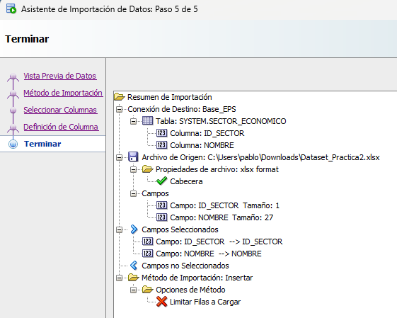

#### 3. Validación y Confirmación de Carga Operativa
Para asegurar que los registros se almacenaron de forma íntegra y sin pérdidas en el motor de Oracle, se ejecutaron las sentencias de control DQL en la hoja de trabajo:

```sql
SELECT * FROM SECTOR_ECONOMICO;
SELECT COUNT(*) FROM SECTOR_ECONOMICO;
```

**Resultado obtenido en consola:**
* **Total de registros importados con éxito:** 4 registros.

*Evidencia visual de la cuadrícula de resultados y el conteo total (`COUNT(*)`):*

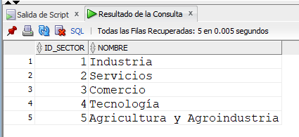

---

### Tabla: DEPARTAMENTO (Orden No. 2 de la Guía)

#### 1. Justificación Jerárquica e Integridad Referencial
La tabla DEPARTAMENTO se cargó en la posición número 2 siguiendo el orden secuencial establecido en la sección 3.3 del enunciado. 
* **Dependencias:** Es una entidad fuerte e independiente; no posee llaves foráneas (FK) que dependan de otra tabla.
* **Propósito:** Garantizar que los registros padres existan en el sistema antes de poblar tablas hijas (como MUNICIPIO), evitando errores de clave foránea (ORA-02291).

#### 2. Evidencia del Proceso de Importación (Asistente Visual)
A continuación se muestra la captura de pantalla del asistente de importación de Oracle SQL Developer en su etapa final, confirmando el mapeo correcto de las columnas del archivo origen hacia los atributos físicos de la base de datos:

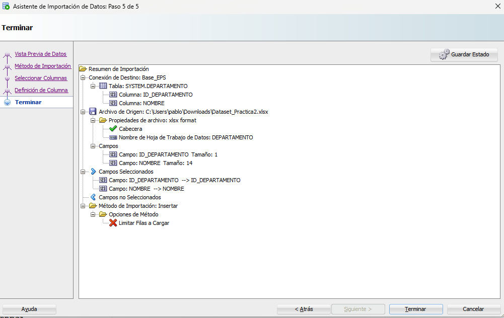

#### 3. Validación y Confirmación de Carga Operativa
Para asegurar que los registros se almacenaron de forma íntegra y sin pérdidas en el motor de Oracle, se ejecutaron las sentencias de control DQL en la hoja de trabajo:

```sql
SELECT * FROM DEPARTAMENTO;
SELECT COUNT(*) FROM DEPARTAMENTO;
```

**Resultado obtenido en consola:**
* **Total de registros importados con éxito:** 4 registros.

*Evidencia visual de la cuadrícula de resultados y el conteo total (`COUNT(*)`):*

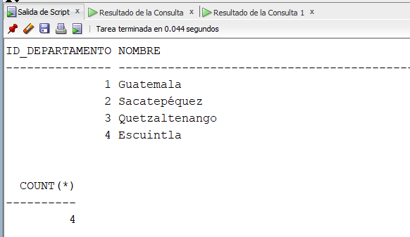

---


### Tabla: ESTADO_COLOCACION (Orden No. 3 de la Guía)

#### 1. Justificación Jerárquica e Integridad Referencial
La tabla ESTADO_COLOCACION se cargó en la posición número 3 siguiendo el orden secuencial establecido en la sección 3.3 del enunciado. 
* **Dependencias:** Es una entidad fuerte e independiente; no posee llaves foráneas (FK) que dependan de otra tabla.
* **Propósito:** Garantizar que los registros padres existan en el sistema antes de poblar tablas hijas (como MUNICIPIO), evitando errores de clave foránea (ORA-02291).

#### 2. Evidencia del Proceso de Importación (Asistente Visual)
A continuación se muestra la captura de pantalla del asistente de importación de Oracle SQL Developer en su etapa final, confirmando el mapeo correcto de las columnas del archivo origen hacia los atributos físicos de la base de datos:

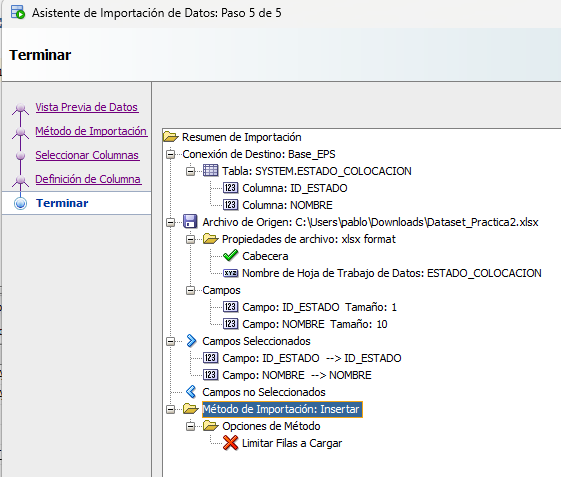

#### 3. Validación y Confirmación de Carga Operativa
Para asegurar que los registros se almacenaron de forma íntegra y sin pérdidas en el motor de Oracle, se ejecutaron las sentencias de control DQL en la hoja de trabajo:

```sql
SELECT * FROM ESTADO_COLOCACION;
SELECT COUNT(*) FROM ESTADO_COLOCACION;
```

**Resultado obtenido en consola:**
* **Total de registros importados con éxito:** 3 registros.

*Evidencia visual de la cuadrícula de resultados y el conteo total (`COUNT(*)`):*

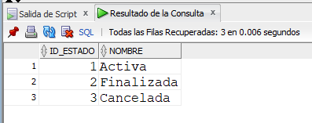

---

### Tabla: TIPO_EVALUACION (Orden No. 4 de la Guía)

#### 1. Justificación Jerárquica e Integridad Referencial
La tabla TIPO_EVALUACION se cargó en la posición número 4 siguiendo el orden secuencial establecido en la sección 3.3 del enunciado. 
* **Dependencias:** Es una entidad fuerte e independiente; no posee llaves foráneas (FK) que dependan de otra tabla.
* **Propósito:** Garantizar que los registros padres existan en el sistema antes de poblar tablas hijas (como MUNICIPIO), evitando errores de clave foránea (ORA-02291).

#### 2. Evidencia del Proceso de Importación (Asistente Visual)
A continuación se muestra la captura de pantalla del asistente de importación de Oracle SQL Developer en su etapa final, confirmando el mapeo correcto de las columnas del archivo origen hacia los atributos físicos de la base de datos:

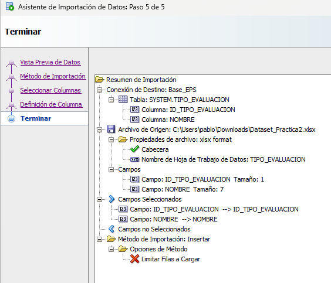

#### 3. Validación y Confirmación de Carga Operativa
Para asegurar que los registros se almacenaron de forma íntegra y sin pérdidas en el motor de Oracle, se ejecutaron las sentencias de control DQL en la hoja de trabajo:

```sql
SELECT * FROM TIPO_EVALUACION;
SELECT COUNT(*) FROM TIPO_EVALUACION;
```

**Resultado obtenido en consola:**
* **Total de registros importados con éxito:** 3 registros.

*Evidencia visual de la cuadrícula de resultados y el conteo total (`COUNT(*)`):*

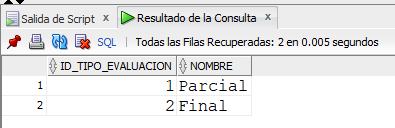

---

### Tabla: INSTITUTO (Orden No. 5 de la Guía)

#### 1. Justificación Jerárquica e Integridad Referencial
La tabla INSTITUTO se cargó en la posición número 5 siguiendo el orden secuencial establecido en la sección 3.3 del enunciado. 
* **Dependencias:** Es una entidad independiente; no posee llaves foráneas que dependan de otras tablas del sistema.
* **Propósito:** Garantizar que los registros padres existan en el sistema antes de poblar las tablas hijas (como CATEDRATICO_SUPERVISOR y ESTUDIANTE), evitando así cualquier violación de integridad referencial (Foreign Key Error).

#### 2. Evidencia del Proceso de Importación (Asistente Visual)
A continuación se muestra la captura de pantalla del asistente de importación de Oracle SQL Developer en su etapa final, confirmando el mapeo correcto de las columnas del archivo origen hacia los atributos físicos de la base de datos:

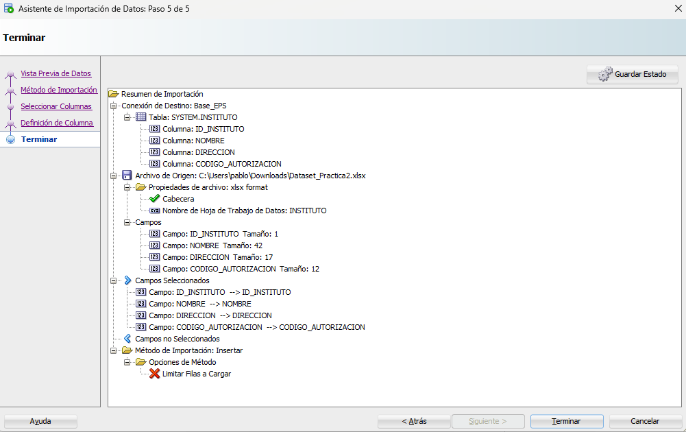

#### 3. Validación y Confirmación de Carga Operativa
Para asegurar que los registros se almacenaron de forma íntegra y sin pérdidas en el motor de Oracle, se ejecutaron las sentencias de control DQL en la hoja de trabajo:

```sql
SELECT * FROM INSTITUTO;
SELECT COUNT(*) FROM INSTITUTO;
```

**Resultado obtenido en consola:**
* **Total de registros importados con éxito:** 3 registros.

*Evidencia visual de la cuadrícula de resultados y el conteo total (`COUNT(*)`):*

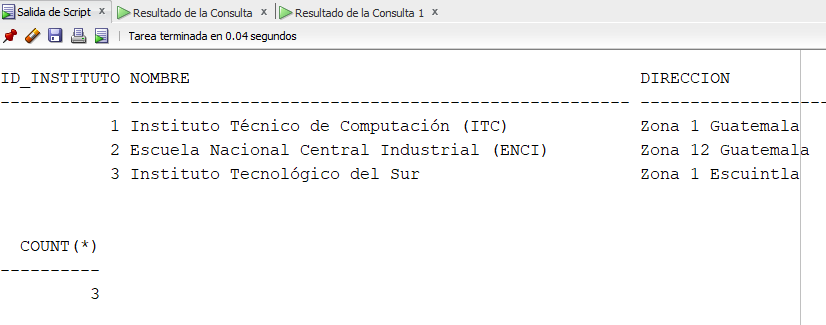

---

### Tabla: CRITERIO_EVALUACION (Orden No. 6 de la Guía)

#### 1. Justificación Jerárquica e Integridad Referencial
La tabla CRITERIO_EVALUACION se cargó en la posición número 6 siguiendo el orden secuencial establecido en la sección 3.3 del enunciado. 
* **Dependencias:** Es una entidad independiente; no requiere de llaves foráneas para ser poblada.
* **Propósito:** Garantizar que los criterios de calificación existan antes de vincularlos en la tabla hija DETALLE_EVALUACION, evitando violaciones de integridad referencial.

#### 2. Evidencia del Proceso de Importación (Asistente Visual)
A continuación se muestra la captura de pantalla del asistente de importación de Oracle SQL Developer en su etapa final, confirmando el mapeo correcto de las columnas del archivo origen hacia los atributos físicos de la base de datos:

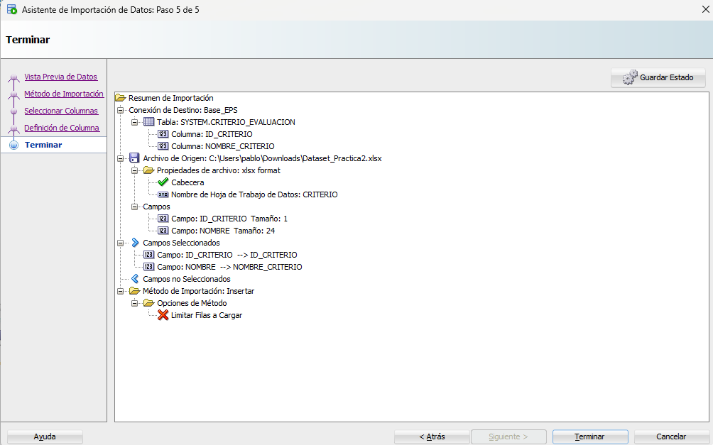

#### 3. Validación y Confirmación de Carga Operativa
Para asegurar que los registros se almacenaron de forma íntegra y sin pérdidas en el motor de Oracle, se ejecutaron las sentencias de control DQL en la hoja de trabajo:

```sql
SELECT * FROM CRITERIO_EVALUACION;
SELECT COUNT(*) FROM CRITERIO_EVALUACION;
```

**Resultado obtenido en consola:**
* **Total de registros importados con éxito:** 5 registros.

*Evidencia visual de la cuadrícula de resultados y el conteo total (`COUNT(*)`):*

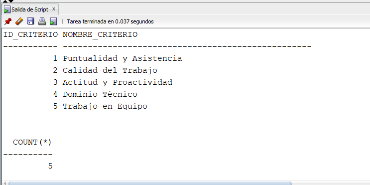

---

### Tabla: MUNICIPIO (Orden No. 7 de la Guía)

#### 1. Justificación Jerárquica e Integridad Referencial
La tabla MUNICIPIO se cargó en la posición número 7 siguiendo el orden secuencial establecido en la sección 3.3 del enunciado. 
* **Dependencias:** Depende directamente de la tabla DEPARTAMENTO por medio de su llave foránea id_departamento.
* **Propósito:** Se carga inmediatamente después de DEPARTAMENTO para asegurar que cada municipio pueda asociarse a un código de departamento ya existente en el sistema, evitando errores ORA-02291 de clave foránea.

#### 2. Evidencia del Proceso de Importación (Asistente Visual)
A continuación se muestra la captura de pantalla del asistente de importación de Oracle SQL Developer en su etapa final, confirmando el mapeo correcto de las columnas del archivo origen hacia los atributos físicos de la base de datos:

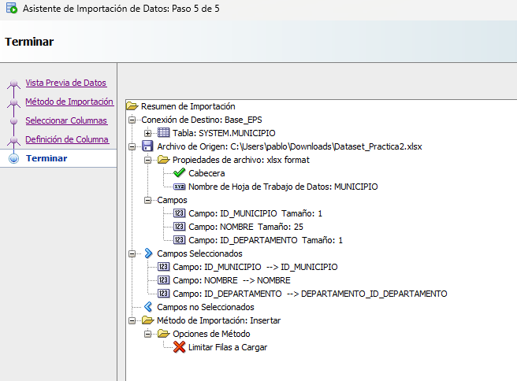

#### 3. Validación y Confirmación de Carga Operativa
Para asegurar que los registros se almacenaron de forma íntegra y sin pérdidas en el motor de Oracle, se ejecutaron las sentencias de control DQL en la hoja de trabajo:

```sql
SELECT * FROM MUNICIPIO;
SELECT COUNT(*) FROM MUNICIPIO;
```

**Resultado obtenido en consola:**
* **Total de registros importados con éxito:** 8 registros.

*Evidencia visual de la cuadrícula de resultados y el conteo total (`COUNT(*)`):*

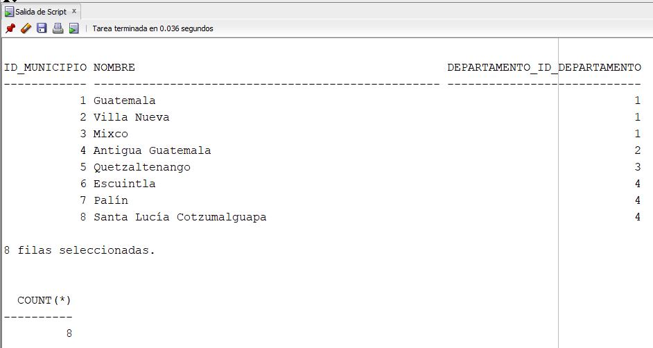

---

### Tabla: EMPRESA (Orden No. 8 de la Guía)

#### 1. Justificación Jerárquica e Integridad Referencial
La tabla EMPRESA se cargó en la posición número 8 siguiendo el orden secuencial establecido en la sección 3.3 del enunciado. 
* **Dependencias:** Es una entidad independiente en el modelo físico actual, ya que el sector económico fue integrado como un atributo directo de la tabla.
* **Propósito:** Registrar las organizaciones en el sistema antes de crear sus ofertas de plazas (PLAZA) y sus enlaces corporativos (CONTACTO_EMPRESARIAL), evitando errores de clave foránea en las entidades hijas.

#### 2. Evidencia del Proceso de Importación (Asistente Visual)
A continuación se muestra la captura de pantalla del asistente de importación de Oracle SQL Developer en su etapa final, confirmando el mapeo correcto de las columnas del archivo origen hacia los atributos físicos de la base de datos:

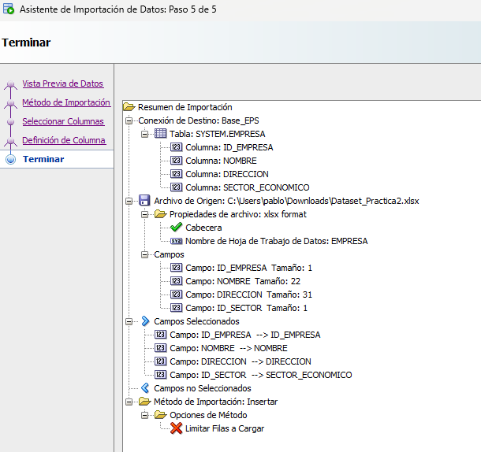

#### 3. Validación y Confirmación de Carga Operativa
Para asegurar que los registros se almacenaron de forma íntegra y sin pérdidas en el motor de Oracle, se ejecutaron las sentencias de control DQL en la hoja de trabajo:

```sql
SELECT * FROM EMPRESA;
SELECT COUNT(*) FROM EMPRESA;
```

**Resultado obtenido en consola:**
* **Total de registros importados con éxito:** 5 registros.

*Evidencia visual de la cuadrícula de resultados y el conteo total (`COUNT(*)`):*

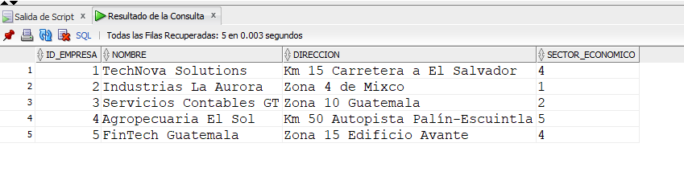

---


### Tabla: CATEDRATICO_SUPERVISOR (Orden No. 9 de la Guía)

#### 1. Justificación Jerárquica e Integridad Referencial
La tabla CATEDRATICO_SUPERVISOR se cargó en la posición número 9 siguiendo el orden secuencial establecido en la sección 3.3 del enunciado. 
* **Dependencias:** Depende directamente de la tabla INSTITUTO mediante su llave foránea de vinculación con la institución académica.
* **Propósito:** Garantizar la existencia previa del instituto emisor antes de dar de alta al docente supervisor, impidiendo violaciones de integridad referencial (ORA-02291).

#### 2. Evidencia del Proceso de Importación (Asistente Visual)
A continuación se muestra la captura de pantalla del asistente de importación de Oracle SQL Developer en su etapa final, confirmando el mapeo correcto de las columnas del archivo origen hacia los atributos físicos de la base de datos:

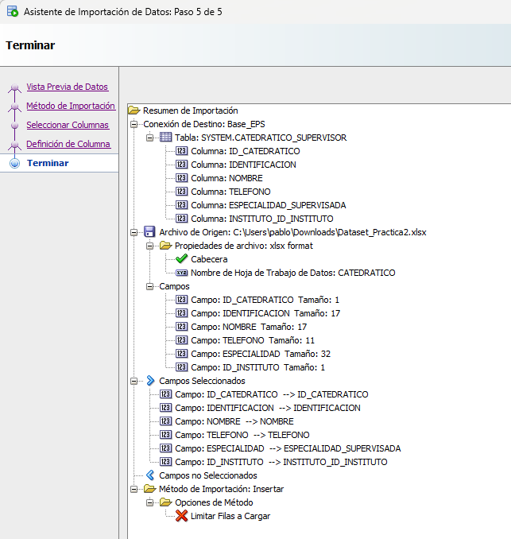

#### 3. Validación y Confirmación de Carga Operativa
Para asegurar que los registros se almacenaron de forma íntegra y sin pérdidas en el motor de Oracle, se ejecutaron las sentencias de control DQL en la hoja de trabajo:

```sql
SELECT * FROM CATEDRATICO_SUPERVISOR;
SELECT COUNT(*) FROM CATEDRATICO_SUPERVISOR;
```

**Resultado obtenido en consola:**
* **Total de registros importados con éxito:** 5 registros.

*Evidencia visual de la cuadrícula de resultados y el conteo total (`COUNT(*)`):*

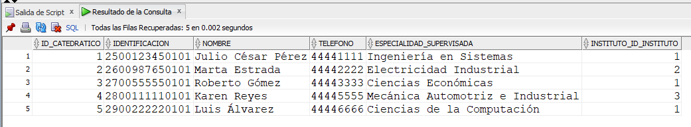

---

### Tabla: CONTACTO_EMPRESARIAL (Orden No. 10 de la Guía)

#### 1. Justificación Jerárquica e Integridad Referencial
La tabla CONTACTO_EMPRESARIAL se cargó en la posición número 10 siguiendo el orden secuencial establecido en la sección 3.3 del enunciado. 
* **Dependencias:** Depende directamente de la tabla EMPRESA a través de su llave foránea.
* **Propósito:** Asegurar la existencia previa de las empresas ofertantes antes de registrar los puestos vacantes disponibles para los estudiantes, previniendo errores de restricción de clave foránea.

#### 2. Evidencia del Proceso de Importación (Asistente Visual)
A continuación se muestra la captura de pantalla del asistente de importación de Oracle SQL Developer en su etapa final, confirmando el mapeo correcto de las columnas del archivo origen hacia los atributos físicos de la base de datos:

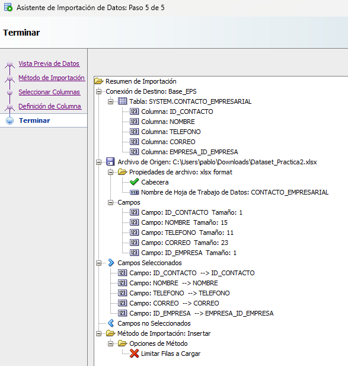

#### 3. Validación y Confirmación de Carga Operativa
Para asegurar que los registros se almacenaron de forma íntegra y sin pérdidas en el motor de Oracle, se ejecutaron las sentencias de control DQL en la hoja de trabajo:

```sql
SELECT * FROM CONTACTO_EMPRESARIAL;
SELECT COUNT(*) FROM CONTACTO_EMPRESARIAL;
```

**Resultado obtenido en consola:**
* **Total de registros importados con éxito:** 7 registros.

*Evidencia visual de la cuadrícula de resultados y el conteo total (`COUNT(*)`):*

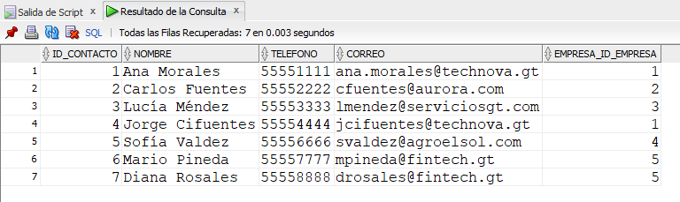

---

### Tabla: PLAZA (Orden No. 11 de la Guía)

#### 1. Justificación Jerárquica e Integridad Referencial
La tabla PLAZA se cargó en la posición número 11 siguiendo el orden secuencial establecido en la sección 3.3 del enunciado. 
* **Dependencias:** Depende directamente de la tabla INSTITUTO mediante su llave foránea de vinculación con la institución académica.
* **Propósito:** Garantizar la existencia previa del instituto emisor antes de dar de alta al docente supervisor, impidiendo violaciones de integridad referencial (ORA-02291).

#### 2. Evidencia del Proceso de Importación (Asistente Visual)
A continuación se muestra la captura de pantalla del asistente de importación de Oracle SQL Developer en su etapa final, confirmando el mapeo correcto de las columnas del archivo origen hacia los atributos físicos de la base de datos:

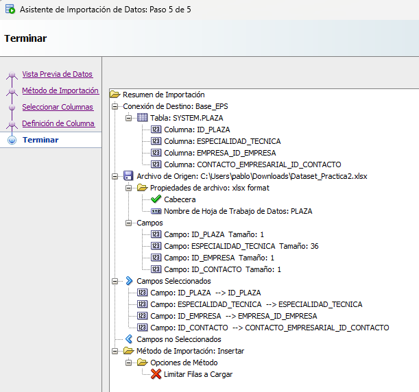

#### 3. Validación y Confirmación de Carga Operativa
Para asegurar que los registros se almacenaron de forma íntegra y sin pérdidas en el motor de Oracle, se ejecutaron las sentencias de control DQL en la hoja de trabajo:

```sql
SELECT * FROM PLAZA;
SELECT COUNT(*) FROM PLAZA;
```

**Resultado obtenido en consola:**
* **Total de registros importados con éxito:** 7 registros.

*Evidencia visual de la cuadrícula de resultados y el conteo total (`COUNT(*)`):*

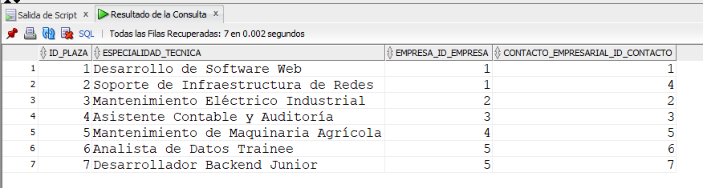

---

### Tabla: ESTUDIANTE (Orden No. 12 de la Guía)

#### 1. Justificación Jerárquica e Integridad Referencial
La tabla ESTUDIANTE se cargó en la posición número 12 siguiendo el orden secuencial establecido en la sección 3.3 del enunciado. 
* **Dependencias:** Depende directamente de las tablas INSTITUTO (para registrar su centro educativo de procedencia) y MUNICIPIO (para su ubicación geográfica) por medio de sus respectivas llaves foráneas.
* **Propósito:** Garantizar que los centros educativos y municipios existan en el sistema antes de dar de alta los expedientes de los alumnos, evitando errores de restricción de clave foránea (ORA-02291).

#### 2. Evidencia del Proceso de Importación (Asistente Visual)
A continuación se muestra la captura de pantalla del asistente de importación de Oracle SQL Developer en su etapa final, confirmando el mapeo correcto de las columnas del archivo origen hacia los atributos físicos de la base de datos:

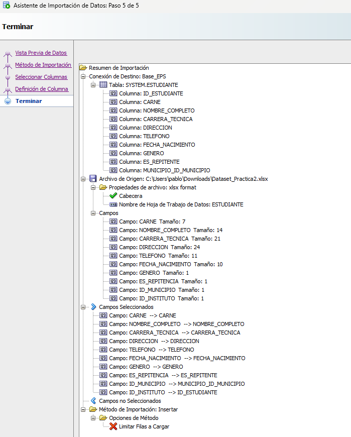

#### 3. Validación y Confirmación de Carga Operativa
Para asegurar que los registros se almacenaron de forma íntegra y sin pérdidas en el motor de Oracle, se ejecutaron las sentencias de control DQL en la hoja de trabajo:

```sql
SELECT * FROM ESTUDIANTE;
SELECT COUNT(*) FROM ESTUDIANTE;
```

**Resultado obtenido en consola:**
* **Total de registros importados con éxito:** 7 registros.

*Evidencia visual de la cuadrícula de resultados y el conteo total (`COUNT(*)`):*

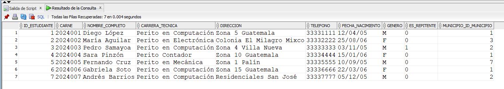

---

### Tabla: COLOCACION (Orden No. 13 de la Guía)

#### 1. Justificación Jerárquica e Integridad Referencial
La tabla COLOCACION se cargó en la posición número 13 siguiendo el orden secuencial establecido en la sección 3.3 del enunciado. 
* **Dependencias:** Depende de las tablas ESTUDIANTE, PLAZA y CATEDRATICO_SUPERVISOR.
* **Propósito:** Actuar como la entidad transaccional central que formaliza la asignación de un estudiante a una plaza de práctica bajo la tutoría de un docente supervisor. Requiere la existencia previa de todas sus llaves foráneas para mantener la integridad relacional.

#### 2. Evidencia del Proceso de Importación (Asistente Visual)
A continuación se muestra la captura de pantalla del asistente de importación de Oracle SQL Developer en su etapa final, confirmando el mapeo correcto de las columnas del archivo origen hacia los atributos físicos de la base de datos:

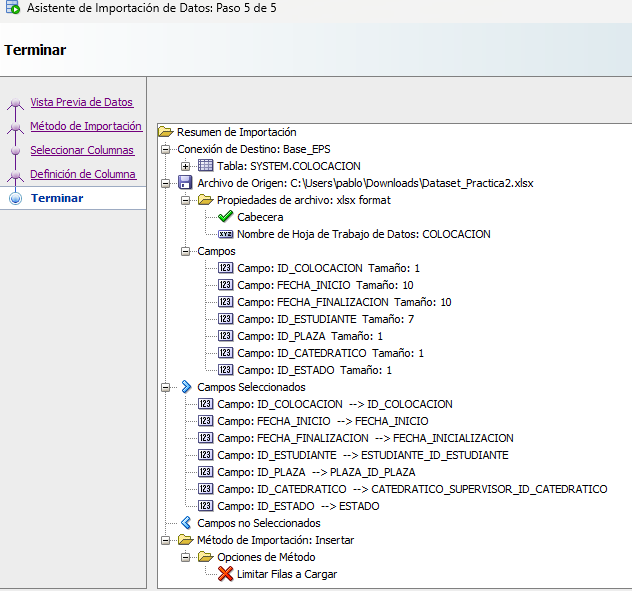

#### 3. Validación y Confirmación de Carga Operativa
Para asegurar que los registros se almacenaron de forma íntegra y sin pérdidas en el motor de Oracle, se ejecutaron las sentencias de control DQL en la hoja de trabajo:

```sql
SELECT * FROM COLOCACION;
SELECT COUNT(*) FROM COLOCACION;
```

**Resultado obtenido en consola:**
* **Total de registros importados con éxito:** 7 registros.

*Evidencia visual de la cuadrícula de resultados y el conteo total (`COUNT(*)`):*

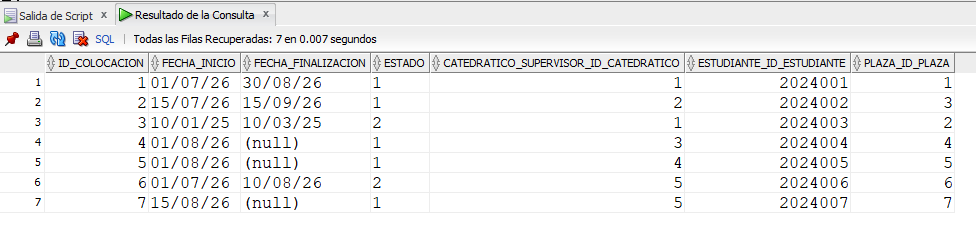

---

### Tabla: BITACORA (Orden No. 14 de la Guía)

#### 1. Justificación Jerárquica e Integridad Referencial
La tabla BITACORA se cargó en la posición número 14 siguiendo el orden secuencial establecido en la sección 3.3 del enunciado. 
* **Dependencias:** Depende directamente de las tablas COLOCACION (que asigna el período de práctica) y CONTACTO_EMPRESARIAL (el representante corporativo que aprueba las actividades).
* **Propósito:** Registrar el seguimiento de las actividades realizadas por el estudiante durante su estancia. Garantiza la existencia previa de una colocación activa y un contacto de empresa válido para evitar errores de clave foránea (ORA-02291).

#### 2. Evidencia del Proceso de Importación (Asistente Visual)
A continuación se muestra la captura de pantalla del asistente de importación de Oracle SQL Developer en su etapa final, confirmando el mapeo correcto de las columnas del archivo origen hacia los atributos físicos de la base de datos:

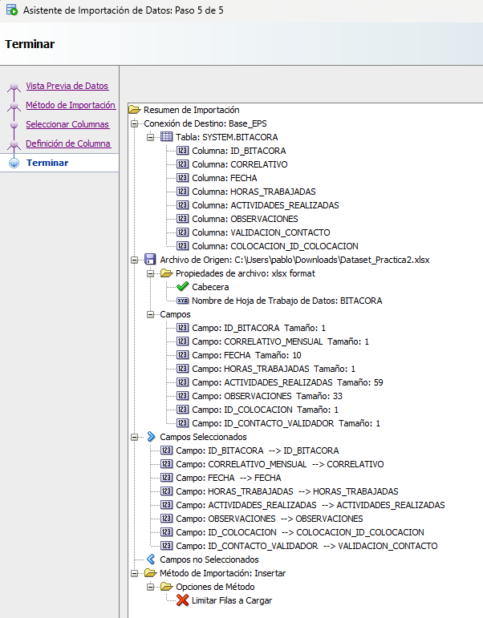

#### 3. Validación y Confirmación de Carga Operativa
Para asegurar que los registros se almacenaron de forma íntegra y sin pérdidas en el motor de Oracle, se ejecutaron las sentencias de control DQL en la hoja de trabajo:

```sql
SELECT * FROM BITACORA;
SELECT COUNT(*) FROM BITACORA;
```

**Resultado obtenido en consola:**
* **Total de registros importados con éxito:** 9 registros.

*Evidencia visual de la cuadrícula de resultados y el conteo total (`COUNT(*)`):*

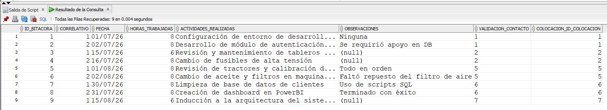

---

### Tabla: EVALUACION (Orden No. 15 de la Guía)

#### 1. Justificación Jerárquica e Integridad Referencial
La tabla EVALUACION se cargó en la posición número 15 siguiendo el orden secuencial establecido en la sección 3.3 del enunciado. 
* **Dependencias:** Depende de las tablas COLOCACION (la práctica sujeta a evaluación) y CATEDRATICO_SUPERVISOR (el docente encargado de asentar la nota).
* **Propósito:** Almacenar el encabezado de las evaluaciones académicas aplicadas a cada estudiante. Exige la existencia previa del proceso de colocación y del catedrático asignado para mantener la coherencia referencial.

#### 2. Evidencia del Proceso de Importación (Asistente Visual)
A continuación se muestra la captura de pantalla del asistente de importación de Oracle SQL Developer en su etapa final, confirmando el mapeo correcto de las columnas del archivo origen hacia los atributos físicos de la base de datos:

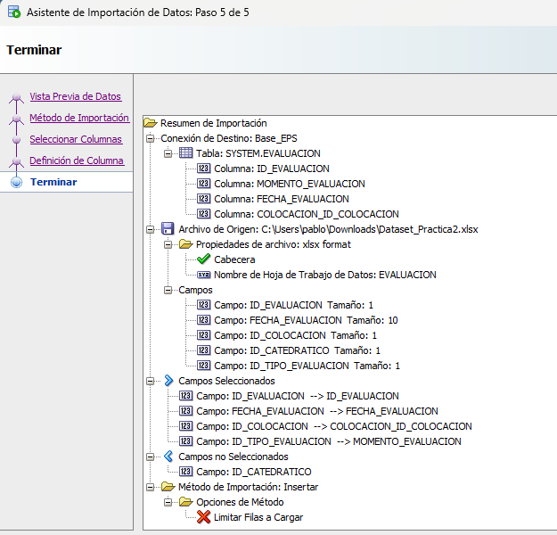

#### 3. Validación y Confirmación de Carga Operativa
Para asegurar que los registros se almacenaron de forma íntegra y sin pérdidas en el motor de Oracle, se ejecutaron las sentencias de control DQL en la hoja de trabajo:

```sql
SELECT * FROM EVALUACION;
SELECT COUNT(*) FROM EVALUACION;
```

**Resultado obtenido en consola:**
* **Total de registros importados con éxito:** 4 registros.

*Evidencia visual de la cuadrícula de resultados y el conteo total (`COUNT(*)`):*

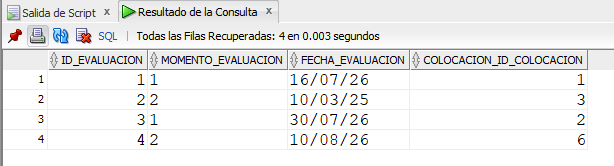

---

### Tabla: DETALLE_EVALUACION (Orden No. 16 de la Guía)

#### 1. Justificación Jerárquica e Integridad Referencial
La tabla DETALLE_EVALUACION se cargó en la posición número 16 siguiendo el orden secuencial establecido en la sección 3.3 del enunciado. 
* **Dependencias:** Depende de las tablas EVALUACION (la evaluación general a la que pertenece) y CRITERIO_EVALUACION (la rúbrica o aspecto específico evaluado).
* **Propósito:** Desglosar la puntuación individual asignada en cada criterio de evaluación. Al ser el último eslabón de la jerarquía, requiere que la evaluación global y los criterios de puntuación existan previamente en el sistema.

#### 2. Evidencia del Proceso de Importación (Asistente Visual)
A continuación se muestra la captura de pantalla del asistente de importación de Oracle SQL Developer en su etapa final, confirmando el mapeo correcto de las columnas del archivo origen hacia los atributos físicos de la base de datos:

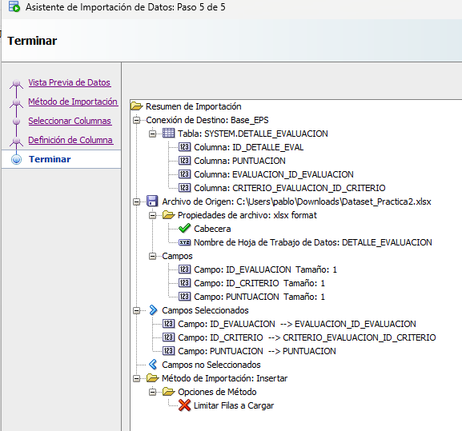

#### 3. Validación y Confirmación de Carga Operativa
Para asegurar que los registros se almacenaron de forma íntegra y sin pérdidas en el motor de Oracle, se ejecutaron las sentencias de control DQL en la hoja de trabajo:

```sql
SELECT * FROM EVALUACION;
SELECT COUNT(*) FROM EVALUACION;
```

**Resultado obtenido en consola:**
* **Total de registros importados con éxito:** 17 registros.

*Evidencia visual de la cuadrícula de resultados y el conteo total (`COUNT(*)`):*

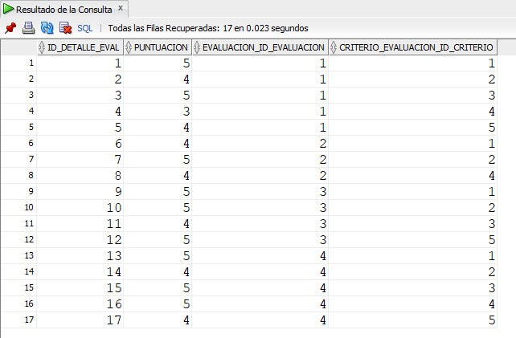

---


# Consultas y resultados de cada Script

## Reporte 1: Directorio de Estudiantes Activos

**Requerimiento del Negocio**
Generar un listado que muestre el carné, el nombre completo del estudiante, el nombre de la empresa donde se encuentra y la especialidad de la plaza, filtrando únicamente las colocaciones en estado "Activa".

**Nombre del Archivo**
`Consulta1.sql`

**Código SQL**
```sql
SELECT 
    e.carne AS "CARNÉ",
    e.nombre_completo AS "NOMBRE COMPLETO",
    emp.nombre AS "EMPRESA",
    p.especialidad_tecnica AS "ESPECIALIDAD DE PLAZA"
FROM COLOCACION c
INNER JOIN ESTUDIANTE e 
    ON c.estudiante_id_estudiante = e.id_estudiante
INNER JOIN PLAZA p 
    ON c.plaza_id_plaza = p.id_plaza
INNER JOIN EMPRESA emp 
    ON p.empresa_id_empresa = emp.id_empresa
INNER JOIN ESTADO_COLOCACION ec 
    ON c.estado = ec.id_estado
WHERE UPPER(ec.nombre) = 'ACTIVA';
```

*Evidencia visual:*

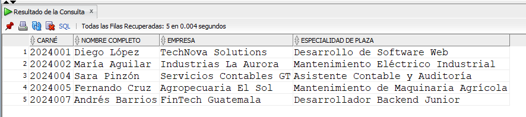


## Reporte 2: Oferta de Plazas por Empresa

**Requerimiento del Negocio**
Mostrar el nombre de cada empresa afiliada junto con la cantidad total de plazas de práctica que ofrecen, ordenando el resultado de mayor a menor según la cantidad de plazas.

**Nombre del Archivo**
`Consulta2.sql`

**Código SQL**
```sql
SELECT 
    emp.nombre AS "EMPRESA",
    COUNT(p.id_plaza) AS "TOTAL PLAZAS"
FROM EMPRESA emp
INNER JOIN PLAZA p 
    ON emp.id_empresa = p.empresa_id_empresa
GROUP BY emp.id_empresa, emp.nombre
ORDER BY "TOTAL PLAZAS" DESC;
```

*Evidencia visual:*

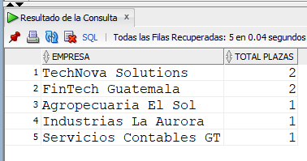


## Reporte 3: Carga de Validación por Contacto Empresarial

**Requerimiento del Negocio**
Listar el nombre del contacto empresarial, el nombre de la empresa a la que pertenece y la suma total de horas validadas en las bitácoras de los estudiantes dentro del rango de fechas de julio a agosto de 2026.

**Nombre del Archivo**
`Consulta3.sql`

**Código SQL**
```sql
SELECT 
    ce.nombre AS "CONTACTO EMPRESARIAL",
    emp.nombre AS "EMPRESA",
    SUM(b.horas_trabajadas) AS "TOTAL HORAS VALIDADAS"
FROM BITACORA b
INNER JOIN CONTACTO_EMPRESARIAL ce 
    ON b.validacion_contacto = ce.id_contacto
INNER JOIN EMPRESA emp 
    ON ce.empresa_id_empresa = emp.id_empresa
WHERE b.fecha BETWEEN TO_DATE('2026-07-01', 'YYYY-MM-DD') 
                  AND TO_DATE('2026-08-31', 'YYYY-MM-DD')
GROUP BY ce.id_contacto, ce.nombre, emp.nombre
ORDER BY "TOTAL HORAS VALIDADAS" DESC;
```

*Evidencia visual:*

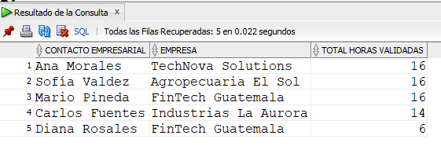


## Reporte 4: Estudiantes en Repitencia

**Requerimiento del Negocio**
Listar a todos los estudiantes que se encuentran realizando su práctica en calidad de repitencia (`ES_REPITENTE = 1`), mostrando el nombre del estudiante, el instituto del que proviene, el contacto empresarial que valida sus bitácoras y el estado actual de su colocación.

**Nombre del Archivo**
`Consulta4.sql`

**Código SQL**
```sql
SELECT 
    e.nombre_completo AS "ESTUDIANTE",
    inst.nombre AS "INSTITUTO",
    ce.nombre AS "CONTACTO EMPRESARIAL",
    ec.nombre AS "ESTADO COLOCACIÓN"
FROM COLOCACION c
INNER JOIN ESTUDIANTE e 
    ON c.estudiante_id_estudiante = e.id_estudiante
INNER JOIN CATEDRATICO_SUPERVISOR cs 
    ON c.catedratico_supervisor_id_catedratico = cs.id_catedratico
INNER JOIN INSTITUTO inst 
    ON cs.instituto_id_instituto = inst.id_instituto
INNER JOIN PLAZA p 
    ON c.plaza_id_plaza = p.id_plaza
INNER JOIN CONTACTO_EMPRESARIAL ce 
    ON p.contacto_empresarial_id_contacto = ce.id_contacto
INNER JOIN ESTADO_COLOCACION ec 
    ON c.estado = ec.id_estado
WHERE e.es_repitente = 1;
```

*Evidencia visual:*

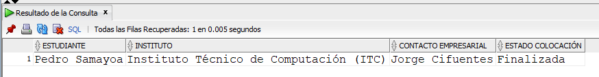


## Reporte 5: Auditoría de Bitácoras

**Requerimiento del Negocio**
Mostrar un listado de las colocaciones que están en estado "Activa", pero que no poseen ningún registro en la tabla de bitácoras durante el último mes (agosto de 2026), identificando al catedrático supervisor responsable.

**Nombre del Archivo**
`Consulta5.sql`

**Código SQL**
```sql
SELECT
    e.carne AS "CARNÉ",
    e.nombre_completo AS "ESTUDIANTE",
    cs.nombre AS "CATEDRÁTICO SUPERVISOR",
    ec.nombre AS "ESTADO COLOCACIÓN"
FROM COLOCACION c

INNER JOIN ESTUDIANTE e
    ON c.estudiante_id_estudiante = e.id_estudiante

INNER JOIN CATEDRATICO_SUPERVISOR cs
    ON c.catedratico_supervisor_id_catedratico = cs.id_catedratico

INNER JOIN ESTADO_COLOCACION ec
    ON c.estado = ec.id_estado

LEFT JOIN BITACORA b
    ON c.id_colocacion = b.colocacion_id_colocacion
   AND b.fecha BETWEEN TO_DATE('2026-08-01','YYYY-MM-DD')
                   AND TO_DATE('2026-08-31','YYYY-MM-DD')

WHERE UPPER(ec.nombre) = 'ACTIVA'
  AND b.id_bitacora IS NULL;
  );
  ```

*Evidencia visual:*

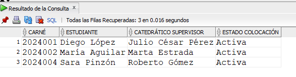