<div align="center">


## UNIVERSIDAD DE SAN CARLOS DE GUATEMALA

### FACULTAD DE INGENIERÍA

### SISTEMAS DE BASES DE DATOS 1

<br><br>

# MANUAL DE CARGA

<br><br>

**Catedrático:** Ing. M.Sc. Luis Fernando Espino Barrios

**Auxiliar:** Allan Josué Rafael Morales

**Nombre:** Pablo Daniel Velásquez Hernández

**Carnet:** 202302232

**Sección:** B

**Semestre:** Segundo Semestre 2026

<br><br>

</div>

## Proceso de Importación de Datos por Tabla

### Tabla: PAIS (Orden No. 1 de la Guía)

#### 1. Justificación Jerárquica e Integridad Referencial
La tabla PAIS se cargó en la posición número 1 siguiendo el orden secuencial establecido en la sección 3.3 del enunciado. 
* **Dependencias:** Es una entidad fuerte e independiente; no posee llaves foráneas (FK) que dependan de otra tabla.
* **Propósito:** Garantizar que los registros padres existan en el sistema antes de poblar tablas hijas (como MUNICIPIO), evitando errores de clave foránea (ORA-02291).

#### 2. Evidencia del Proceso de Importación (Asistente Visual)
A continuación se muestra la captura de pantalla del asistente de importación de Oracle SQL Developer en su etapa final, confirmando el mapeo correcto de las columnas del archivo origen hacia los atributos físicos de la base de datos:

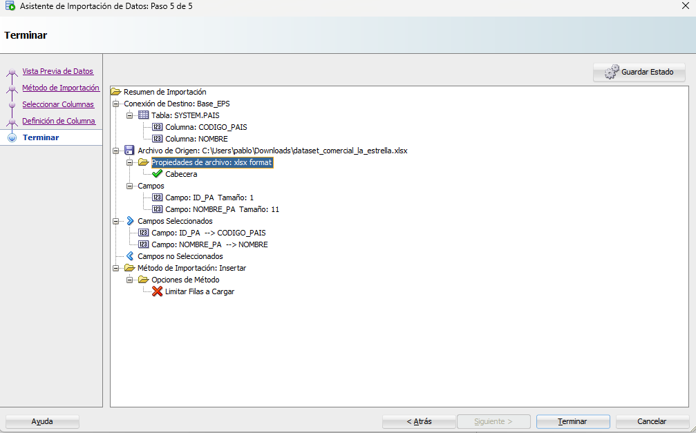

#### 3. Validación y Confirmación de Carga Operativa
Para asegurar que los registros se almacenaron de forma íntegra y sin pérdidas en el motor de Oracle, se ejecutaron las sentencias de control DQL en la hoja de trabajo:

```sql
SELECT * FROM PAIS;
SELECT COUNT(*) FROM PAIS;
```

**Resultado obtenido en consola:**
* **Total de registros importados con éxito:** 3 registros.

*Evidencia visual de la cuadrícula de resultados y el conteo total (`COUNT(*)`):*

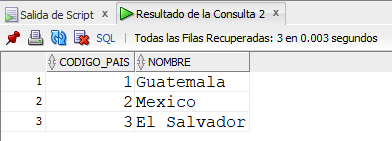

---

### Tabla: TIPO_TIENDA (Orden No. 2 de la Guía)

#### 1. Justificación Jerárquica e Integridad Referencial
La tabla TIPO_TIENDA se cargó en la posición número 2 siguiendo el orden secuencial establecido en la sección 3.3 del enunciado. 
* **Dependencias:** Es una entidad fuerte e independiente; no posee llaves foráneas (FK) que dependan de otra tabla.
* **Propósito:** Garantizar que los registros padres existan en el sistema antes de poblar tablas hijas (como MUNICIPIO), evitando errores de clave foránea (ORA-02291).

#### 2. Evidencia del Proceso de Importación (Asistente Visual)
A continuación se muestra la captura de pantalla del asistente de importación de Oracle SQL Developer en su etapa final, confirmando el mapeo correcto de las columnas del archivo origen hacia los atributos físicos de la base de datos:

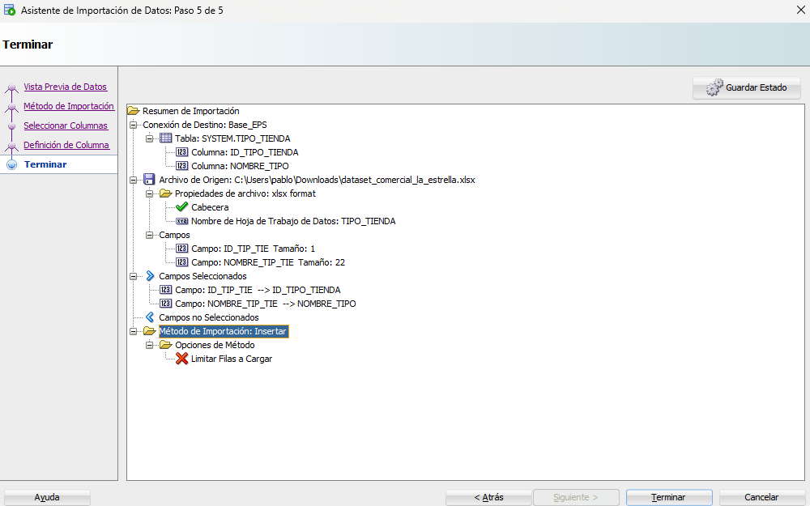

#### 3. Validación y Confirmación de Carga Operativa
Para asegurar que los registros se almacenaron de forma íntegra y sin pérdidas en el motor de Oracle, se ejecutaron las sentencias de control DQL en la hoja de trabajo:

```sql
SELECT * FROM TIPO_TIENDA;
SELECT COUNT(*) FROM TIPO_TIENDA;
```

**Resultado obtenido en consola:**
* **Total de registros importados con éxito:** 4 registros.

*Evidencia visual de la cuadrícula de resultados y el conteo total (`COUNT(*)`):*

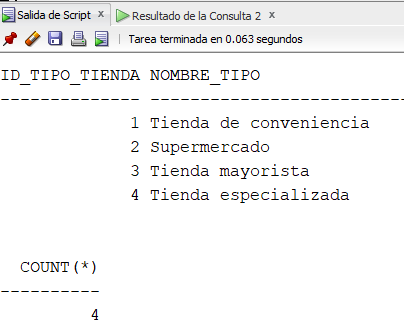

---


### Tabla: TIPO_IDENTIFICACION (Orden No. 3 de la Guía)

#### 1. Justificación Jerárquica e Integridad Referencial
La tabla TIPO_IDENTIFICACION se cargó en la posición número 3 siguiendo el orden secuencial establecido en la sección 3.3 del enunciado. 
* **Dependencias:** Es una entidad fuerte e independiente; no posee llaves foráneas (FK) que dependan de otra tabla.
* **Propósito:** Garantizar que los registros padres existan en el sistema antes de poblar tablas hijas (como MUNICIPIO), evitando errores de clave foránea (ORA-02291).

#### 2. Evidencia del Proceso de Importación (Asistente Visual)
A continuación se muestra la captura de pantalla del asistente de importación de Oracle SQL Developer en su etapa final, confirmando el mapeo correcto de las columnas del archivo origen hacia los atributos físicos de la base de datos:

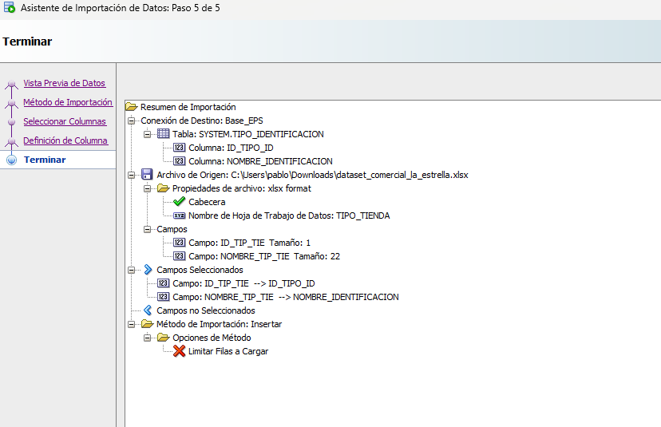

#### 3. Validación y Confirmación de Carga Operativa
Para asegurar que los registros se almacenaron de forma íntegra y sin pérdidas en el motor de Oracle, se ejecutaron las sentencias de control DQL en la hoja de trabajo:

```sql
SELECT * FROM TIPO_IDENTIFICACION;
SELECT COUNT(*) FROM TIPO_IDENTIFICACION;
```

**Resultado obtenido en consola:**
* **Total de registros importados con éxito:** 4 registros.

*Evidencia visual de la cuadrícula de resultados y el conteo total (`COUNT(*)`):*

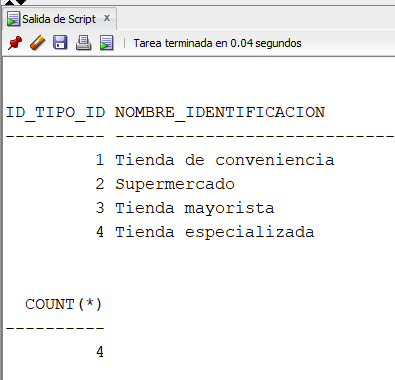

---

### Tabla: CARGO_EMPLEADO (Orden No. 4 de la Guía)

#### 1. Justificación Jerárquica e Integridad Referencial
La tabla CARGO_EMPLEADO se cargó en la posición número 4 siguiendo el orden secuencial establecido en la sección 3.3 del enunciado. 
* **Dependencias:** Es una entidad fuerte e independiente; no posee llaves foráneas (FK) que dependan de otra tabla.
* **Propósito:** Garantizar que los registros padres existan en el sistema antes de poblar tablas hijas (como MUNICIPIO), evitando errores de clave foránea (ORA-02291).

#### 2. Evidencia del Proceso de Importación (Asistente Visual)
A continuación se muestra la captura de pantalla del asistente de importación de Oracle SQL Developer en su etapa final, confirmando el mapeo correcto de las columnas del archivo origen hacia los atributos físicos de la base de datos:

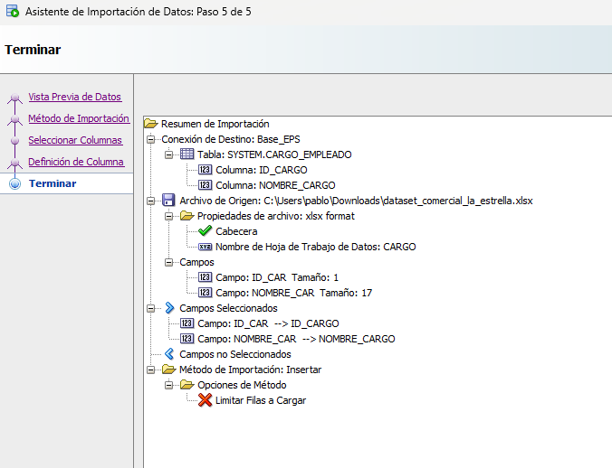

#### 3. Validación y Confirmación de Carga Operativa
Para asegurar que los registros se almacenaron de forma íntegra y sin pérdidas en el motor de Oracle, se ejecutaron las sentencias de control DQL en la hoja de trabajo:

```sql
SELECT * FROM CARGO_EMPLEADO;
SELECT COUNT(*) FROM CARGO_EMPLEADO;
```

**Resultado obtenido en consola:**
* **Total de registros importados con éxito:** 4 registros.

*Evidencia visual de la cuadrícula de resultados y el conteo total (`COUNT(*)`):*

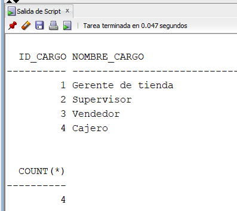

---

### Tabla: CATEGORIA_PRODUCTO (Orden No. 5 de la Guía)

#### 1. Justificación Jerárquica e Integridad Referencial
La tabla CATEGORIA_PRODUCTO se cargó en la posición número 5 siguiendo el orden secuencial establecido en la sección 3.3 del enunciado. 
* **Dependencias:** Es una entidad independiente; no posee llaves foráneas que dependan de otras tablas del sistema.
* **Propósito:** Garantizar que los registros padres existan en el sistema antes de poblar las tablas hijas, evitando así cualquier violación de integridad referencial (Foreign Key Error).

#### 2. Evidencia del Proceso de Importación (Asistente Visual)
A continuación se muestra la captura de pantalla del asistente de importación de Oracle SQL Developer en su etapa final, confirmando el mapeo correcto de las columnas del archivo origen hacia los atributos físicos de la base de datos:

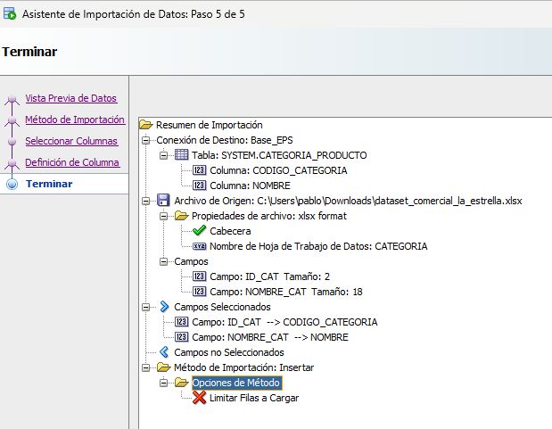

#### 3. Validación y Confirmación de Carga Operativa
Para asegurar que los registros se almacenaron de forma íntegra y sin pérdidas en el motor de Oracle, se ejecutaron las sentencias de control DQL en la hoja de trabajo:

```sql
SELECT * FROM CATEGORIA_PRODUCTO;
SELECT COUNT(*) FROM CATEGORIA_PRODUCTO;
```

**Resultado obtenido en consola:**
* **Total de registros importados con éxito:** 10 registros.

*Evidencia visual de la cuadrícula de resultados y el conteo total (`COUNT(*)`):*

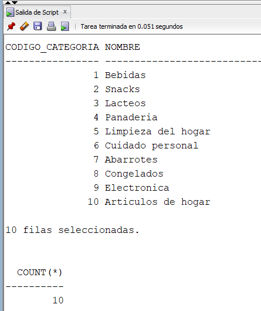

---

### Tabla: MARCA_PRODUCTO (Orden No. 6 de la Guía)

#### 1. Justificación Jerárquica e Integridad Referencial
La tabla MARCA_PRODUCTO se cargó en la posición número 6 siguiendo el orden secuencial establecido en la sección 3.3 del enunciado. 
* **Dependencias:** Es una entidad independiente; no requiere de llaves foráneas para ser poblada.
* **Propósito:** Garantizar que los criterios de calificación existan antes de vincularlos en la tabla hija, evitando violaciones de integridad referencial.

#### 2. Evidencia del Proceso de Importación (Asistente Visual)
A continuación se muestra la captura de pantalla del asistente de importación de Oracle SQL Developer en su etapa final, confirmando el mapeo correcto de las columnas del archivo origen hacia los atributos físicos de la base de datos:

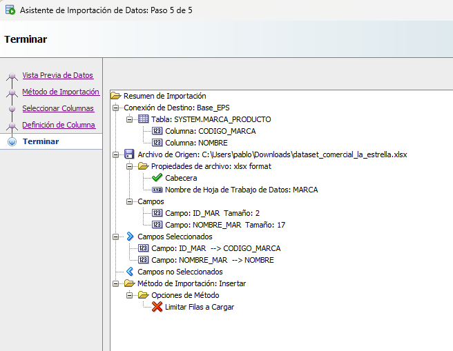

#### 3. Validación y Confirmación de Carga Operativa
Para asegurar que los registros se almacenaron de forma íntegra y sin pérdidas en el motor de Oracle, se ejecutaron las sentencias de control DQL en la hoja de trabajo:

```sql
SELECT * FROM MARCA_PRODUCTO;
SELECT COUNT(*) FROM MARCA_PRODUCTO;
```

**Resultado obtenido en consola:**
* **Total de registros importados con éxito:** 15 registros.

*Evidencia visual de la cuadrícula de resultados y el conteo total (`COUNT(*)`):*

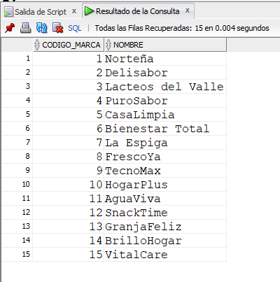

---

### Tabla: ESTADO_VENTA (Orden No. 7 de la Guía)

#### 1. Justificación Jerárquica e Integridad Referencial
La tabla ESTADO_VENTA se cargó en la posición número 7 siguiendo el orden secuencial establecido en la sección 3.3 del enunciado. 
* **Dependencias:** Depende directamente de la tabla DEPARTAMENTO por medio de su llave foránea id_departamento.
* **Propósito:** Se carga inmediatamente después de DEPARTAMENTO para asegurar que cada municipio pueda asociarse a un código de departamento ya existente en el sistema, evitando errores ORA-02291 de clave foránea.

#### 2. Evidencia del Proceso de Importación (Asistente Visual)
A continuación se muestra la captura de pantalla del asistente de importación de Oracle SQL Developer en su etapa final, confirmando el mapeo correcto de las columnas del archivo origen hacia los atributos físicos de la base de datos:

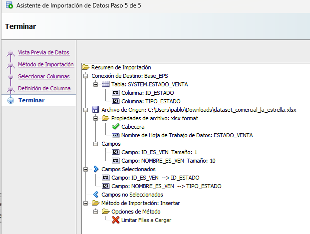

#### 3. Validación y Confirmación de Carga Operativa
Para asegurar que los registros se almacenaron de forma íntegra y sin pérdidas en el motor de Oracle, se ejecutaron las sentencias de control DQL en la hoja de trabajo:

```sql
SELECT * FROM ESTADO_VENTA;
SELECT COUNT(*) FROM ESTADO_VENTA;
```

**Resultado obtenido en consola:**
* **Total de registros importados con éxito:** 3 registros.

*Evidencia visual de la cuadrícula de resultados y el conteo total (`COUNT(*)`):*

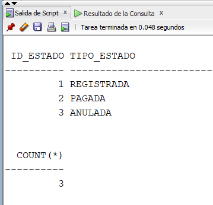

---

### Tabla: METODO_PAGO (Orden No. 8 de la Guía)

#### 1. Justificación Jerárquica e Integridad Referencial
La tabla METODO_PAGO se cargó en la posición número 8 siguiendo el orden secuencial establecido en la sección 3.3 del enunciado. 
* **Dependencias:** Es una entidad independiente en el modelo físico actual, ya que el sector económico fue integrado como un atributo directo de la tabla.
* **Propósito:** Registrar las organizaciones en el sistema antes de crear y sus enlaces corporativos, evitando errores de clave foránea en las entidades hijas.

#### 2. Evidencia del Proceso de Importación (Asistente Visual)
A continuación se muestra la captura de pantalla del asistente de importación de Oracle SQL Developer en su etapa final, confirmando el mapeo correcto de las columnas del archivo origen hacia los atributos físicos de la base de datos:

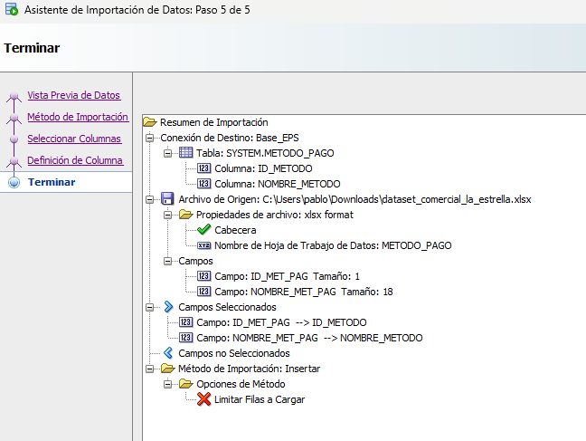

#### 3. Validación y Confirmación de Carga Operativa
Para asegurar que los registros se almacenaron de forma íntegra y sin pérdidas en el motor de Oracle, se ejecutaron las sentencias de control DQL en la hoja de trabajo:

```sql
SELECT * FROM METODO_PAGO;
SELECT COUNT(*) FROM METODO_PAGO;
```

**Resultado obtenido en consola:**
* **Total de registros importados con éxito:** 4 registros.

*Evidencia visual de la cuadrícula de resultados y el conteo total (`COUNT(*)`):*

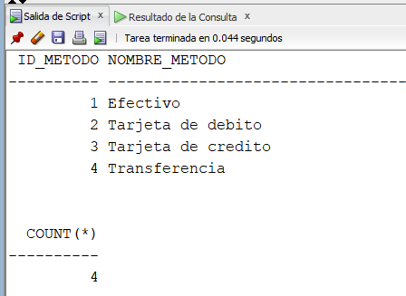

---


### Tabla: DEPARTAMENTO (Orden No. 9 de la Guía)

#### 1. Justificación Jerárquica e Integridad Referencial
La tabla DEPARTAMENTO se cargó en la posición número 9 siguiendo el orden secuencial establecido en la sección 3.3 del enunciado. 
* **Dependencias:** Depende directamente de la tabla mediante su llave foránea de vinculación.
* **Propósito:** Garantizar la existencia previa del emisor antes de dar de alta, impidiendo violaciones de integridad referencial (ORA-02291).

#### 2. Evidencia del Proceso de Importación (Asistente Visual)
A continuación se muestra la captura de pantalla del asistente de importación de Oracle SQL Developer en su etapa final, confirmando el mapeo correcto de las columnas del archivo origen hacia los atributos físicos de la base de datos:

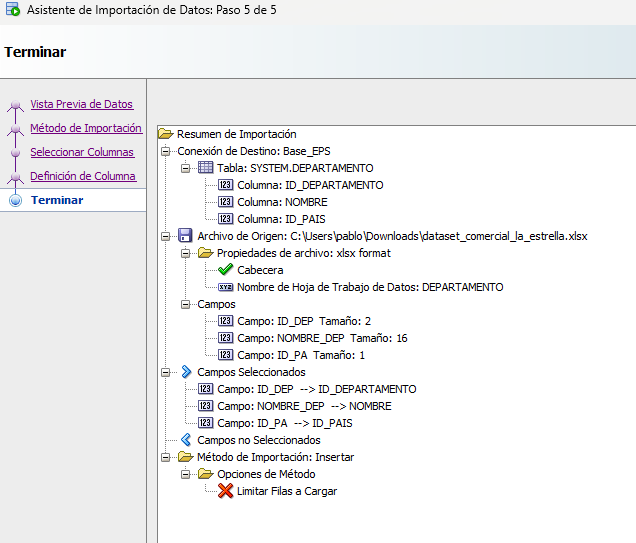

#### 3. Validación y Confirmación de Carga Operativa
Para asegurar que los registros se almacenaron de forma íntegra y sin pérdidas en el motor de Oracle, se ejecutaron las sentencias de control DQL en la hoja de trabajo:

```sql
SELECT * FROM DEPARTAMENTO;
SELECT COUNT(*) FROM DEPARTAMENTO;
```

**Resultado obtenido en consola:**
* **Total de registros importados con éxito:** 32 registros.

*Evidencia visual de la cuadrícula de resultados y el conteo total (`COUNT(*)`):*

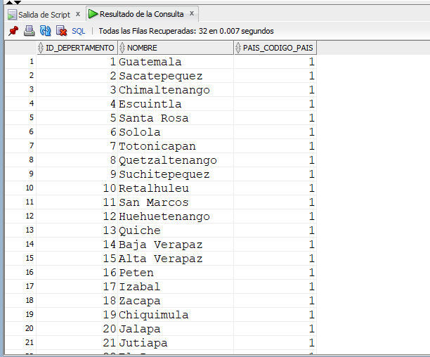

---

### Tabla: PRODUCTO (Orden No. 10 de la Guía)

#### 1. Justificación Jerárquica e Integridad Referencial
La tabla PRODUCTO se cargó en la posición número 10 siguiendo el orden secuencial establecido en la sección 3.3 del enunciado. 
* **Dependencias:** Depende directamente de la tabla a través de su llave foránea.
* **Propósito:** Asegurar la existencia previa de las empresas ofertantes antes de registrar los puestos vacantes disponibles, previniendo errores de restricción de clave foránea.

#### 2. Evidencia del Proceso de Importación (Asistente Visual)
A continuación se muestra la captura de pantalla del asistente de importación de Oracle SQL Developer en su etapa final, confirmando el mapeo correcto de las columnas del archivo origen hacia los atributos físicos de la base de datos:

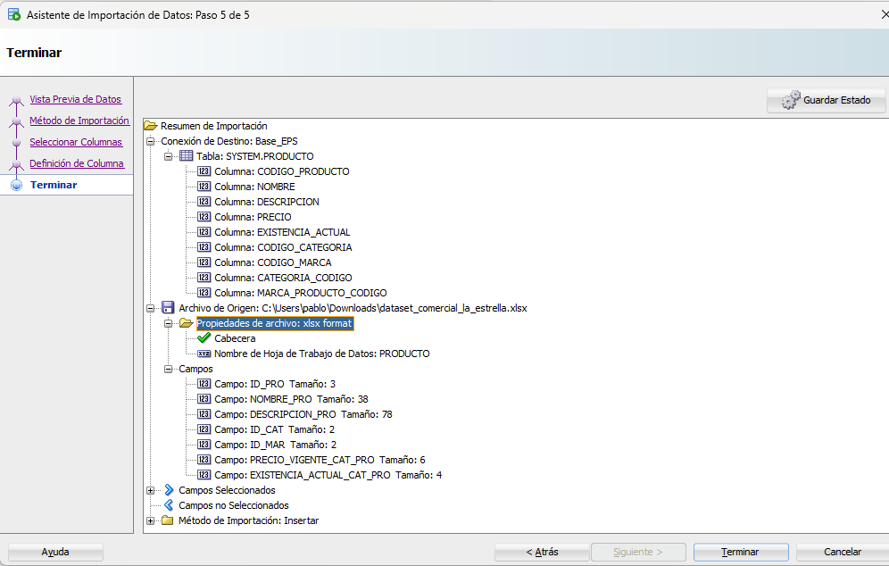

#### 3. Validación y Confirmación de Carga Operativa
Para asegurar que los registros se almacenaron de forma íntegra y sin pérdidas en el motor de Oracle, se ejecutaron las sentencias de control DQL en la hoja de trabajo:

```sql
SELECT * FROM PRODUCTO;
SELECT COUNT(*) FROM PRODUCTO;
```

**Resultado obtenido en consola:**
* **Total de registros importados con éxito:** 114 registros.

*Evidencia visual de la cuadrícula de resultados y el conteo total (`COUNT(*)`):*

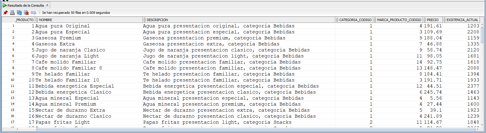

---

### Tabla: MUNICIPIO (Orden No. 11 de la Guía)

#### 1. Justificación Jerárquica e Integridad Referencial
La tabla MUNICIPIO se cargó en la posición número 11 siguiendo el orden secuencial establecido en la sección 3.3 del enunciado. 
* **Dependencias:** Depende directamente de la tabla  mediante su llave foránea de vinculación.
* **Propósito:** Garantizar la existencia previa del  emisor antes de dar de alta al docente supervisor, impidiendo violaciones de integridad referencial (ORA-02291).

#### 2. Evidencia del Proceso de Importación (Asistente Visual)
A continuación se muestra la captura de pantalla del asistente de importación de Oracle SQL Developer en su etapa final, confirmando el mapeo correcto de las columnas del archivo origen hacia los atributos físicos de la base de datos:

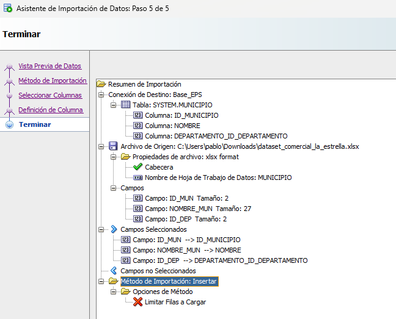

#### 3. Validación y Confirmación de Carga Operativa
Para asegurar que los registros se almacenaron de forma íntegra y sin pérdidas en el motor de Oracle, se ejecutaron las sentencias de control DQL en la hoja de trabajo:

```sql
SELECT * FROM MUNICIPIO;
SELECT COUNT(*) FROM MUNICIPIO;
```

**Resultado obtenido en consola:**
* **Total de registros importados con éxito:** 80 registros.

*Evidencia visual de la cuadrícula de resultados y el conteo total (`COUNT(*)`):*

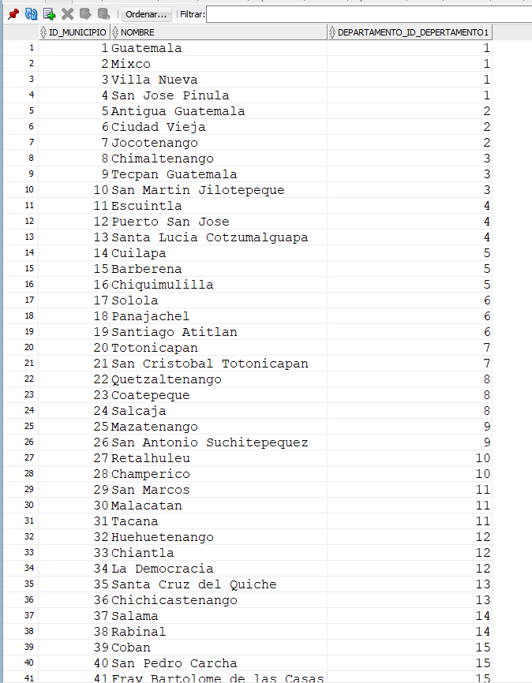

---

### Tabla: TIENDA (Orden No. 12 de la Guía)

#### 1. Justificación Jerárquica e Integridad Referencial
La tabla TIENDA se cargó en la posición número 12 siguiendo el orden secuencial establecido en la sección 3.3 del enunciado. 
* **Dependencias:** Depende directamente de las tablas (Para registrar su centro educativo de procedencia) y MUNICIPIO (para su ubicación geográfica) por medio de sus respectivas llaves foráneas.
* **Propósito:** Garantizar que los centros educativos y municipios existan en el sistema antes de dar de alta los expedientes de los, evitando errores de restricción de clave foránea (ORA-02291).

#### 2. Evidencia del Proceso de Importación (Asistente Visual)
A continuación se muestra la captura de pantalla del asistente de importación de Oracle SQL Developer en su etapa final, confirmando el mapeo correcto de las columnas del archivo origen hacia los atributos físicos de la base de datos:

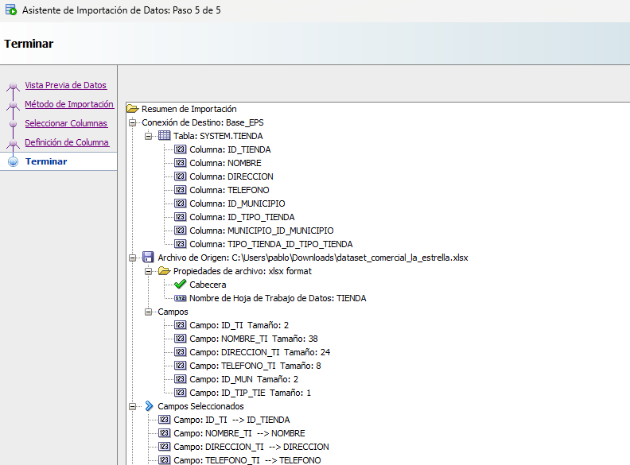

#### 3. Validación y Confirmación de Carga Operativa
Para asegurar que los registros se almacenaron de forma íntegra y sin pérdidas en el motor de Oracle, se ejecutaron las sentencias de control DQL en la hoja de trabajo:

```sql
SELECT * FROM TIENDA;
SELECT COUNT(*) FROM TIENDA;
```

**Resultado obtenido en consola:**
* **Total de registros importados con éxito:** 7 registros.

*Evidencia visual de la cuadrícula de resultados y el conteo total (`COUNT(*)`):*

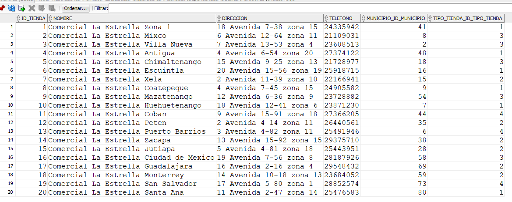

---

### Tabla: EMPLEADO (Orden No. 13 de la Guía)

#### 1. Justificación Jerárquica e Integridad Referencial
La tabla EMPLEADO se cargó en la posición número 13 siguiendo el orden secuencial establecido en la sección 3.3 del enunciado. 
* **Dependencias:** Depende de las tablas TIENDA y MUNICIPIO.
* **Propósito:** Actuar como la entidad transaccional central que formaliza la asignación de un estudiante a una plaza de práctica bajo la tutoría de un docente supervisor. Requiere la existencia previa de todas sus llaves foráneas para mantener la integridad relacional.

#### 2. Evidencia del Proceso de Importación (Asistente Visual)
A continuación se muestra la captura de pantalla del asistente de importación de Oracle SQL Developer en su etapa final, confirmando el mapeo correcto de las columnas del archivo origen hacia los atributos físicos de la base de datos:

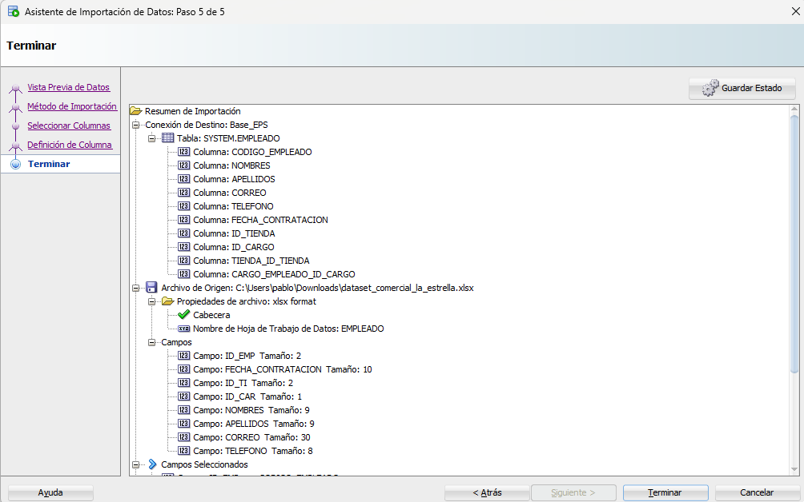

#### 3. Validación y Confirmación de Carga Operativa
Para asegurar que los registros se almacenaron de forma íntegra y sin pérdidas en el motor de Oracle, se ejecutaron las sentencias de control DQL en la hoja de trabajo:

```sql
SELECT * FROM EMPLEADO;
SELECT COUNT(*) FROM EMPLEADO;
```

**Resultado obtenido en consola:**
* **Total de registros importados con éxito:** 88 registros.

*Evidencia visual de la cuadrícula de resultados y el conteo total (`COUNT(*)`):*

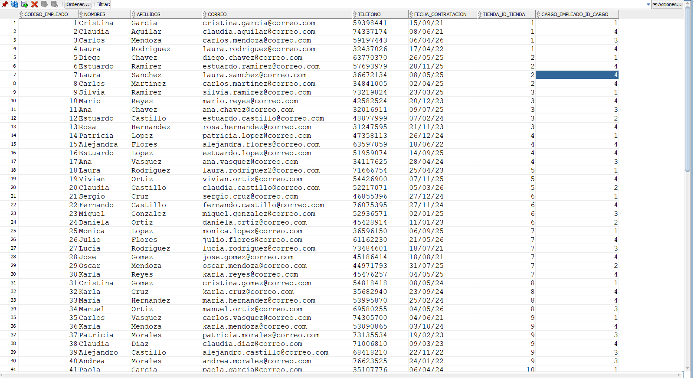

---

### Tabla: CLIENTE (Orden No. 14 de la Guía)

#### 1. Justificación Jerárquica e Integridad Referencial
La tabla CLIENTE se cargó en la posición número 14 siguiendo el orden secuencial establecido en la sección 3.3 del enunciado. 
* **Dependencias:** Depende directamente de las tablas TIENDA y MUNICIPIO.
* **Propósito:** Registrar el seguimiento de las actividades realizadas por el estudiante durante su estancia. Garantiza la existencia previa de una colocación activa y un contacto de empresa válido para evitar errores de clave foránea (ORA-02291).

#### 2. Evidencia del Proceso de Importación (Asistente Visual)
A continuación se muestra la captura de pantalla del asistente de importación de Oracle SQL Developer en su etapa final, confirmando el mapeo correcto de las columnas del archivo origen hacia los atributos físicos de la base de datos:

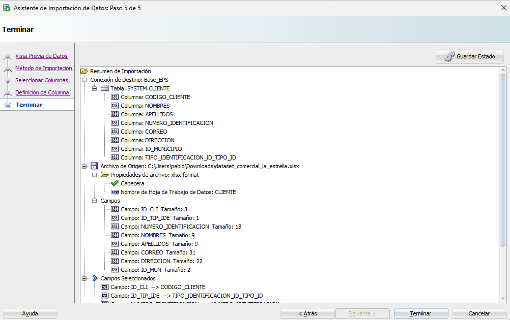

#### 3. Validación y Confirmación de Carga Operativa
Para asegurar que los registros se almacenaron de forma íntegra y sin pérdidas en el motor de Oracle, se ejecutaron las sentencias de control DQL en la hoja de trabajo:

```sql
SELECT * FROM CLIENTE;
SELECT COUNT(*) FROM CLIENTE;
```

**Resultado obtenido en consola:**
* **Total de registros importados con éxito:** 300 registros.

*Evidencia visual de la cuadrícula de resultados y el conteo total (`COUNT(*)`):*

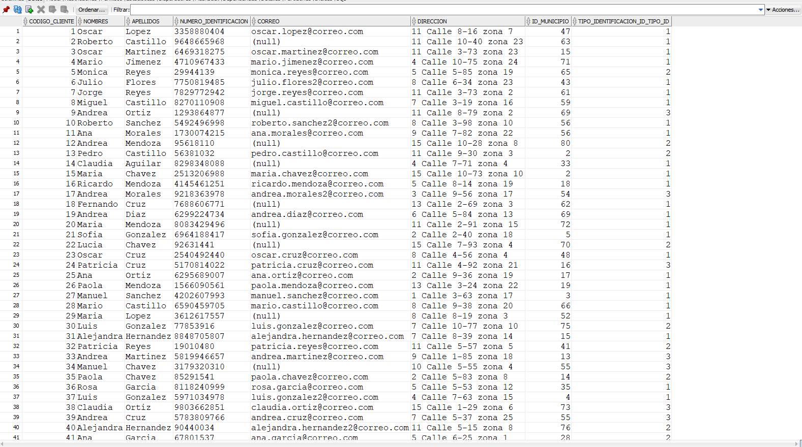

---

### Tabla: VENTA (Orden No. 15 de la Guía)

#### 1. Justificación Jerárquica e Integridad Referencial
La tabla VENTA se cargó en la posición número 15 siguiendo el orden secuencial establecido en la sección 3.3 del enunciado. 
* **Dependencias:** Depende de las tablas  TIENDA, EMPLEADO y CLIENTE.
* **Propósito:** Almacenar el encabezado de las evaluaciones académicas aplicadas a cada estudiante. Exige la existencia previa del proceso de colocación y del catedrático asignado para mantener la coherencia referencial.

#### 2. Evidencia del Proceso de Importación (Asistente Visual)
A continuación se muestra la captura de pantalla del asistente de importación de Oracle SQL Developer en su etapa final, confirmando el mapeo correcto de las columnas del archivo origen hacia los atributos físicos de la base de datos:

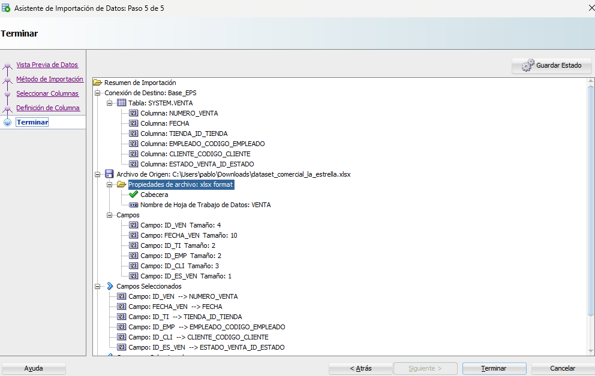

#### 3. Validación y Confirmación de Carga Operativa
Para asegurar que los registros se almacenaron de forma íntegra y sin pérdidas en el motor de Oracle, se ejecutaron las sentencias de control DQL en la hoja de trabajo:

```sql
SELECT * FROM VENTA;
SELECT COUNT(*) FROM VENTA;
```

**Resultado obtenido en consola:**
* **Total de registros importados con éxito:** 1,500 registros.

*Evidencia visual de la cuadrícula de resultados y el conteo total (`COUNT(*)`):*

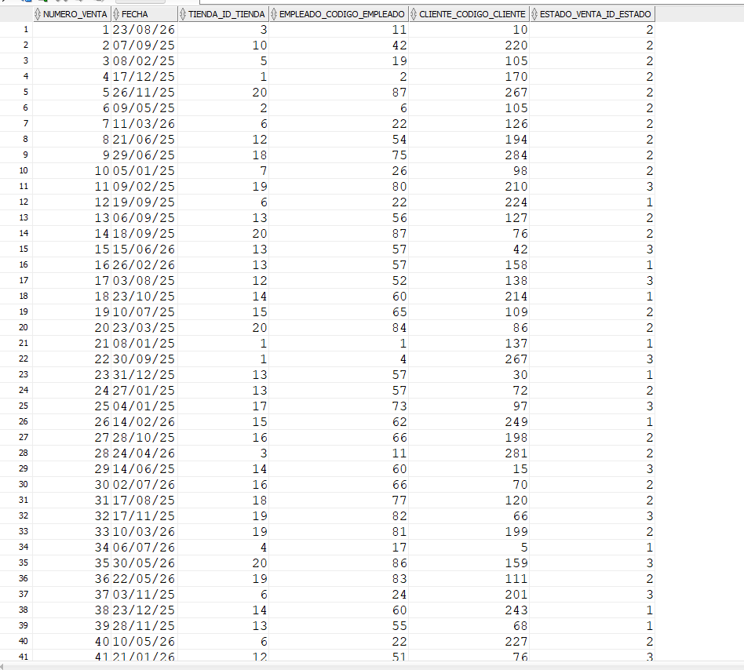

---

### Tabla: DETALLE_VENTA (Orden No. 16 de la Guía)

#### 1. Justificación Jerárquica e Integridad Referencial
La tabla DETALLE_VENTA se cargó en la posición número 16 siguiendo el orden secuencial establecido en la sección 3.3 del enunciado. 
* **Dependencias:** Depende de las tablas DETALLE_VENTA (la evaluación general a la que pertenece) y DETALLE_VENTA (la rúbrica o aspecto específico evaluado).
* **Propósito:** Desglosar la puntuación individual asignada en cada criterio de evaluación. Al ser el último eslabón de la jerarquía, requiere que la evaluación global y los criterios de puntuación existan previamente en el sistema.

#### 2. Evidencia del Proceso de Importación (Asistente Visual)
A continuación se muestra la captura de pantalla del asistente de importación de Oracle SQL Developer en su etapa final, confirmando el mapeo correcto de las columnas del archivo origen hacia los atributos físicos de la base de datos:

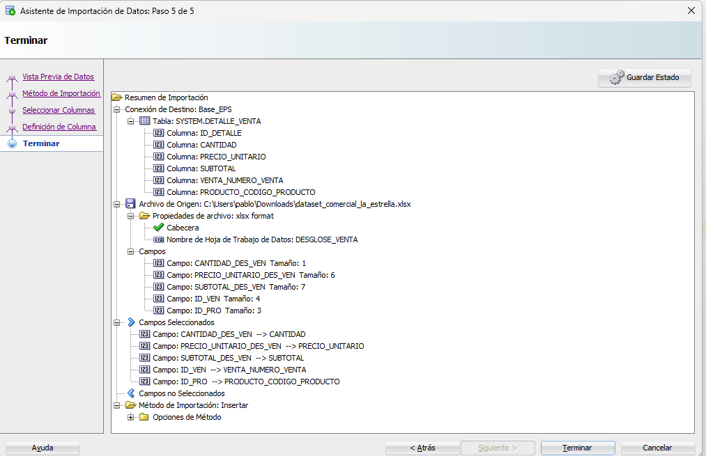

#### 3. Validación y Confirmación de Carga Operativa
Para asegurar que los registros se almacenaron de forma íntegra y sin pérdidas en el motor de Oracle, se ejecutaron las sentencias de control DQL en la hoja de trabajo:

```sql
SELECT * FROM DETALLE_VENTA;
SELECT COUNT(*) FROM DETALLE_VENTA;
```

**Resultado obtenido en consola:**
* **Total de registros importados con éxito:** 3,687 registros.

*Evidencia visual de la cuadrícula de resultados y el conteo total (`COUNT(*)`):*

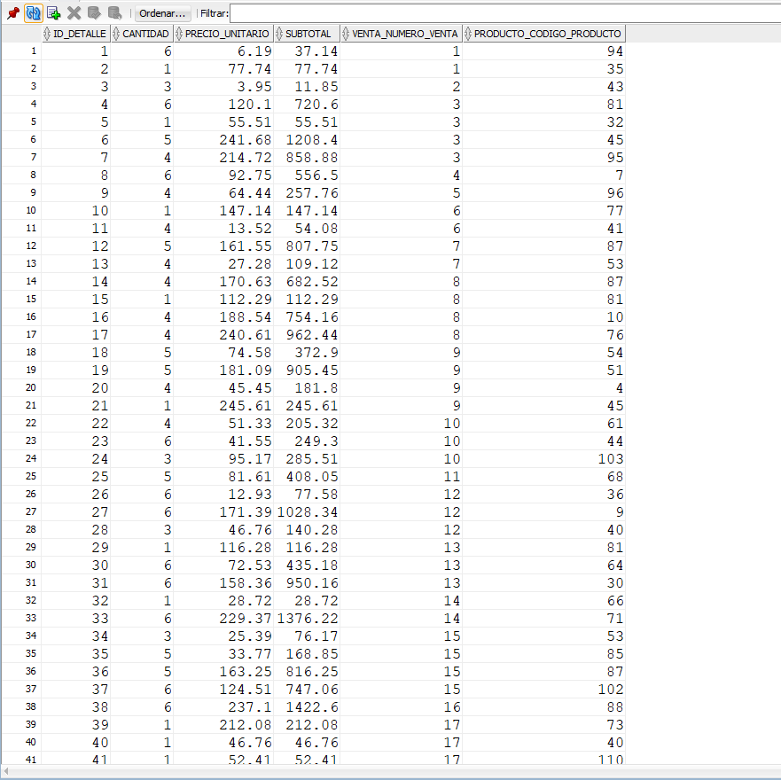

---


### Tabla: DETALLE_PAGO (Orden No. 17 de la Guía)

#### 1. Justificación Jerárquica e Integridad Referencial
La tabla DETALLE_PAGO se cargó en la posición número 17 siguiendo el orden secuencial establecido en la sección 3.3 del enunciado. 
* **Dependencias:** Depende de las tablas DETALLE_PAGO (la evaluación general a la que pertenece) y DETALLE_PAGO (la rúbrica o aspecto específico evaluado).
* **Propósito:** Desglosar la puntuación individual asignada en cada criterio de evaluación. Al ser el último eslabón de la jerarquía, requiere que la evaluación global y los criterios de puntuación existan previamente en el sistema.

#### 2. Evidencia del Proceso de Importación (Asistente Visual)
A continuación se muestra la captura de pantalla del asistente de importación de Oracle SQL Developer en su etapa final, confirmando el mapeo correcto de las columnas del archivo origen hacia los atributos físicos de la base de datos:

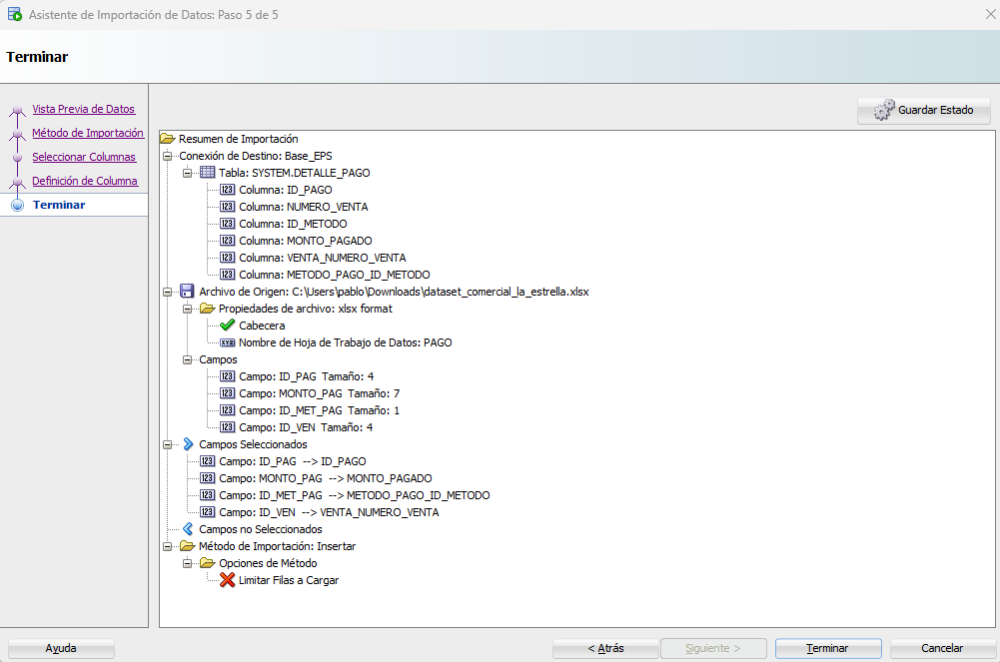

#### 3. Validación y Confirmación de Carga Operativa
Para asegurar que los registros se almacenaron de forma íntegra y sin pérdidas en el motor de Oracle, se ejecutaron las sentencias de control DQL en la hoja de trabajo:

```sql
SELECT * FROM DETALLE_PAGO;
SELECT COUNT(*) FROM DETALLEDETALLE_PAGO_VENTA;
```

**Resultado obtenido en consola:**
* **Total de registros importados con éxito:** 1,388 registros.

*Evidencia visual de la cuadrícula de resultados y el conteo total (`COUNT(*)`):*

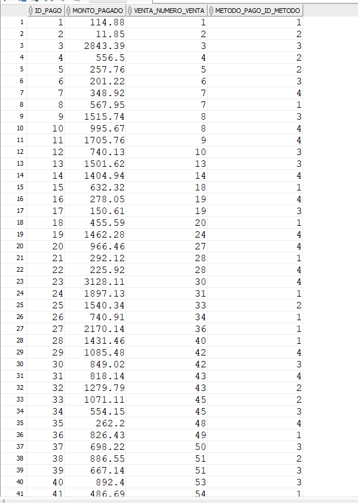

---


# Consultas y resultados de cada Script

## Reporte 1: Ventas por tienda y ubicación

**Requerimiento del Negocio**
Generar un listado que muestre el tienda, municipio, departamento, país, cantidad de ventas y total facturado; excluir anuladas.

**Nombre del Archivo**
`Consulta1.sql`

**Código SQL**
```sql
-- CONSULTA 1: Ventas por tienda y ubicación

-- 1. SECCIÓN SELECT: Define cuáles columnas mostrar en la tabla de resultados final.
SELECT 
    t.nombre AS tienda,                  -- Muestra el nombre de la tienda física. Usa "AS" para renombrar la columna limpia.
    m.nombre AS municipio,               -- Muestra el nombre del municipio donde está la tienda física.
    d.nombre AS departamento,            -- Muestra el nombre del departamento político de esa ubicación.
    p.nombre AS pais,                    -- Muestra el país al que pertenece la tienda física.
    
    -- COUNT(DISTINCT ...): Cuenta los números de factura únicos para esa tienda geográfica.
    -- El "DISTINCT" evita que una factura con 5 artículos se cuente 5 veces; solo la contará como 1 venta.
    COUNT(DISTINCT v.numero_venta) AS cantidad_ventas,
    
    -- SUM(...): Agarra los importes parciales de la tabla de detalles y los suma todos.
    -- Esto asegura los ingresos reales facturados por la tienda.
    SUM(dv.subtotal) AS total_facturado

-- 2. SECCIÓN FROM: Declara la tabla principal de donde partimos (la transacción base).
FROM 
    venta v         -- "v" es el apodo corto para no escribir "venta" todo el tiempo.

-- 3. SECCIÓN INNER JOIN: Realiza los puentes para unificar la base de datos esparcida.
INNER JOIN detalle_venta dv 
    ON v.numero_venta = dv.venta_numero_venta         -- Conecta cada factura principal con la lista de productos que contiene.
INNER JOIN estado_venta ev 
    ON v.estado_venta_id_estado = ev.id_estado       -- Conecta la factura con su tabla de estados (Válida, Anulada, etc.).
INNER JOIN tienda t 
    ON v.tienda_id_tienda = t.id_tienda               -- Conecta la venta con la tienda física donde se realizó.
INNER JOIN municipio m 
    ON t.municipio_id_municipio = m.id_municipio       -- Cruza la tienda con su municipio correspondiente.
INNER JOIN departamento d 
    ON m.departamento_id_departamento = d.id_departamento -- Cruza el municipio con su respectivo departamento político.
INNER JOIN pais p 
    ON d.pais_codigo_pais = p.codigo_pais             -- Cruza el departamento para saber a qué país pertenece.


-- 4. SECCIÓN WHERE: Aplica los filtros de exclusión antes de calcular los totales.
WHERE 
    -- UPPER(...): Convierte temporalmente el texto del estado a MAYÚSCULAS para comparar con seguridad.
    -- <> 'ANULADA': El operador "<>" significa "diferente de", por ende descarta facturas invalidadas.
    UPPER(ev.tipo_estado) <> 'ANULADA' 

-- 5. SECCIÓN GROUP BY: Agrupa los registros individuales en bloques.
GROUP BY 
    t.nombre,                            -- Agrupa por tienda.
    m.nombre,                            -- Agrupa por municipio.
    d.nombre,                            -- Agrupa por departamento.
    p.nombre                             -- Agrupa por país.
    -- NOTA DE REGLA ORACLE: Cualquier columna del SELECT que no use una función matemática (como COUNT o SUM)
    -- obligatoriamente tiene que listarse en esta sección para que la base de datos sepa cómo separar los grupos.

-- 6. SECCIÓN ORDER BY: Ordena la información final en base a lo requerido.
ORDER BY 
    total_facturado DESC;                -- Ordena la tabla de mayor a menor (DESCendente) según el dinero ingresado.

```

*Evidencia visual:*

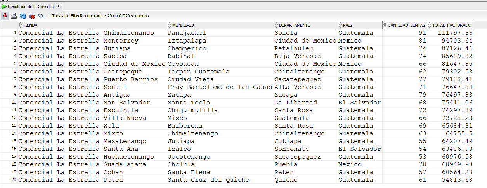


## Reporte 2: Ventas por tipo de tienda

**Requerimiento del Negocio**
Mostrar el tipo de tienda, cantidad de tiendas, cantidad de ventas y monto facturado.

**Nombre del Archivo**
`Consulta2.sql`

**Código SQL**
```sql
SELECT
    tt.nombre_tipo AS tipo_tienda,                    -- Muestra el nombre del tipo de tienda.
    
    COUNT(DISTINCT t.id_tienda) AS cantidad_tiendas,   -- Cuenta las tiendas únicas de cada tipo.
    COUNT(DISTINCT v.numero_venta) AS cantidad_ventas, -- Cuenta las facturas o transacciones únicas.
    SUM(dv.subtotal) AS monto_facturado                -- Suma los subtotales para el dinero total ingresado.
    
FROM
    tienda t                                           -- Tabla base de los establecimientos.
    
INNER JOIN venta v
    ON t.id_tienda = v.tienda_id_tienda                -- Conecta las tiendas con sus ventas.
INNER JOIN tipo_tienda tt
    ON t.tipo_tienda_id_tipo_tienda = tt.id_tipo_tienda -- Conecta las tiendas con su tipo o categoría.
INNER JOIN detalle_venta dv
    ON v.numero_venta = dv.venta_numero_venta          -- Conecta las ventas con los artículos comprados.
INNER JOIN estado_venta ev
    ON v.estado_venta_id_estado = ev.id_estado         -- Conecta las ventas con su estado actual.
    
GROUP BY
    tt.nombre_tipo                                     -- Agrupa los cálculos por tipo de tienda.
    
ORDER BY
    monto_facturado DESC;                              -- Ordena los resultados de mayor a menor monto.
```

*Evidencia visual:*

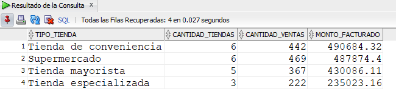


## Reporte 3: Productos más vendidos

**Requerimiento del Negocio**
Listar el código, producto, categoría, marca, unidades vendidas y monto generado; excluir anuladas.

**Nombre del Archivo**
`Consulta3.sql`

**Código SQL**
```sql
SELECT
    p.codigo_producto AS codigo,                       -- Muestra el código único de identificación del producto.
    p.nombre AS producto,                              -- Muestra el nombre comercial del producto.
    p.categoria_codigo AS categoria,                   -- Muestra el código de la categoría a la que pertenece.
    mp.nombre AS marca,                                -- Muestra el nombre de la marca del producto.
    SUM(dv.cantidad) AS unidades_vendidas,             -- Suma todas las cantidades para dar el total de piezas vendidas.
    SUM(dv.subtotal) AS monto_generado                 -- Suma todos los subtotales para dar los ingresos totales del producto.
FROM
    venta v                                            -- Tabla principal de transacciones de venta.
INNER JOIN detalle_venta dv
    ON v.numero_venta = dv.venta_numero_venta          -- Conecta cada venta con la lista de productos que contiene.
INNER JOIN producto p
    ON dv.producto_codigo_producto = p.codigo_producto -- Conecta cada línea de detalle con el producto específico comprado.
INNER JOIN marca_producto mp
    ON p.marca_producto_codigo = mp.codigo_marca       -- Conecta el producto con su marca para obtener su nombre.
INNER JOIN estado_venta ev
    ON v.estado_venta_id_estado = ev.id_estado         -- Conecta la venta con su estado de validez actual.
WHERE
    UPPER(ev.tipo_estado) <> 'ANULADA'                 -- Excluye de los totales todas las ventas que fueron canceladas.
GROUP BY
    p.codigo_producto,                                 -- Agrupa los cálculos matemáticos por código de producto.
    p.nombre,                                          -- Agrupa por el nombre del producto.
    p.categoria_codigo,                                -- Agrupa por el código de su categoría.
    mp.nombre                                          -- Agrupa por el nombre de su marca.
ORDER BY
    monto_generado DESC;                               -- Ordena el reporte de mayor a menor según los ingresos generados.
```

*Evidencia visual:*

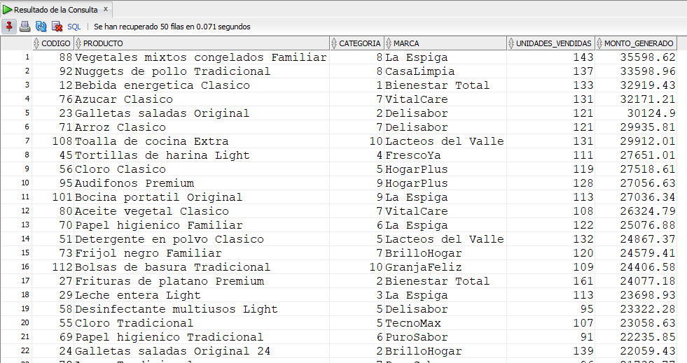


## Reporte 4: Desempeño de empleados

**Requerimiento del Negocio**
Listar a todos  empleados, cargo, tienda, cantidad de ventas atendidas y total facturado.

**Nombre del Archivo**
`Consulta4.sql`

**Código SQL**
```sql
SELECT
    e.nombres || ' ' || e.apellidos AS empleado,       -- Une el nombre y apellido para mostrar al empleado completo.
    ce.nombre_cargo AS cargo,                          -- Muestra el nombre del puesto o cargo del empleado.
    t.nombre AS tienda,                                -- Muestra el nombre de la tienda donde trabaja o vendió.
    
    COUNT(DISTINCT v.numero_venta) AS ventas_atendidas, -- Cuenta las facturas únicas que atendió el empleado.
    SUM(dv.subtotal) AS total_facturado                -- Suma todos los subtotales para obtener su total vendido.

FROM
    venta v                                            -- Tabla principal que registra las transacciones de venta.

INNER JOIN detalle_venta dv
    ON v.numero_venta = dv.venta_numero_venta          -- Conecta cada venta con la lista de productos que contiene.
INNER JOIN empleado e
    ON v.empleado_codigo_empleado = e.codigo_empleado  -- Conecta la venta con el empleado que la atendió.
INNER JOIN cargo_empleado ce
    ON e.cargo_empleado_id_cargo = ce.id_cargo         -- Conecta al empleado con su cargo para saber su puesto.
INNER JOIN tienda t
    ON v.tienda_id_tienda = t.id_tienda                -- Conecta la venta con la tienda física correspondiente.
INNER JOIN estado_venta ev
    ON v.estado_venta_id_estado = ev.id_estado         -- Conecta la venta con su estado de validez actual.

WHERE
    UPPER(ev.tipo_estado) <> 'ANULADA'                 -- Excluye de las métricas todas las ventas canceladas.

GROUP BY
    e.nombres,                                         -- Agrupa por el nombre del empleado.
    e.apellidos,                                       -- Agrupa por el apellido del empleado.
    ce.nombre_cargo,                                   -- Agrupa por el puesto del empleado.
    t.nombre                                           -- Agrupa por el nombre de la tienda.

ORDER BY
    total_facturado DESC;                              -- Ordena a los empleados de mayor a menor según lo facturado.
```

*Evidencia visual:*

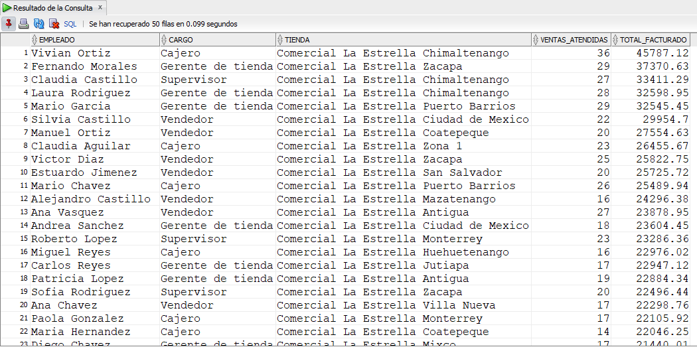


## Reporte 5: Clientes con mayor compra

**Requerimiento del Negocio**
Mostrar un listado de los clientes, municipio de residencia, cantidad de ventas pagadas y monto total comprado.

**Nombre del Archivo**
`Consulta5.sql`

**Código SQL**
```sql
SELECT
    c.nombres || ' ' || c.apellidos AS cliente,         -- Une el nombre y apellido del comprador en una sola columna.
    m.nombre AS municipio_residencia,                   -- Muestra el nombre del municipio donde vive el cliente.
    COUNT(DISTINCT v.numero_venta) AS ventas_pagadas,   -- Cuenta las facturas únicas que el cliente ha pagado.
    SUM(dv.subtotal) AS monto_total_comprado            -- Suma los subtotales para obtener el dinero total invertido.

FROM
    venta v                                             -- Tabla principal que registra las transacciones de venta.
INNER JOIN detalle_venta dv
    ON v.numero_venta = dv.venta_numero_venta           -- Conecta cada venta con sus líneas de productos comprados.

INNER JOIN cliente c
    ON v.cliente_codigo_cliente = c.codigo_cliente      -- Conecta la venta con el perfil del cliente que compró.

INNER JOIN municipio m
    ON c.id_municipio = m.id_municipio                  -- Conecta al cliente con su municipio de residencia.

INNER JOIN estado_venta ev
    ON v.estado_venta_id_estado = ev.id_estado          -- Conecta la venta con su estado de validez actual.

WHERE
    UPPER(ev.tipo_estado) <> 'ANULADA'                  -- Excluye de los totales las compras que fueron canceladas.

GROUP BY
    c.nombres,                                          -- Agrupa los cálculos por el nombre del cliente.
    c.apellidos,                                        -- Agrupa los cálculos por el apellido del cliente.
    m.nombre                                            -- Agrupa los cálculos por el municipio de residencia.

ORDER BY
    monto_total_comprado DESC;                          -- Ordena la lista de mayor a menor según el dinero total comprado.
  ```

*Evidencia visual:*

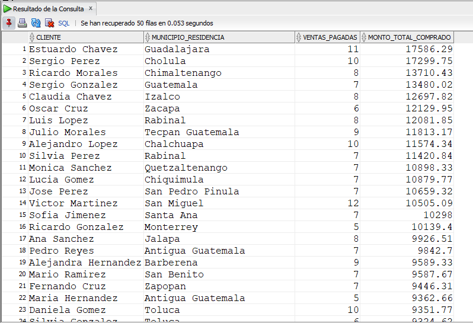

## Reporte 6: Facturación por categoría y marca

**Requerimiento del Negocio**
Mostrar un listado de las categorías, marca, unidades vendidas y total facturado.

**Nombre del Archivo**
`Consulta6.sql`

**Código SQL**
```sql
SELECT
    cp.nombre AS categoria,                            -- Muestra el nombre de la categoría del producto.
    mp.nombre AS marca,                                -- Muestra el nombre de la marca del producto.
    SUM(dv.cantidad) AS unidades_vendidas,             -- Suma las cantidades para dar el total de piezas vendidas.
    SUM(dv.subtotal) AS total_facturado                -- Suma los subtotales para obtener el dinero total ingresado.

FROM
    venta v                                            -- Tabla principal de transacciones de venta.

INNER JOIN detalle_venta dv
    ON v.numero_venta = dv.venta_numero_venta          -- Conecta cada venta con la lista de productos que contiene.
INNER JOIN producto p
    ON dv.producto_codigo_producto = p.codigo_producto -- Conecta cada línea de detalle con el producto específico comprado.
INNER JOIN categoria_producto cp
    ON p.categoria_codigo = cp.codigo_categoria        -- Conecta el producto con su tabla de categorías.
INNER JOIN marca_producto mp
    ON p.marca_producto_codigo = mp.codigo_marca       -- Conecta el producto con su marca para obtener su nombre.
INNER JOIN estado_venta ev
    ON v.estado_venta_id_estado = ev.id_estado         -- Conecta la venta con su estado de validez actual.

WHERE
    UPPER(ev.tipo_estado) <> 'ANULADA'                 -- Excluye de las métricas todas las ventas canceladas.

GROUP BY
    cp.nombre,                                         -- Agrupa los cálculos matemáticos por nombre de categoría.
    mp.nombre                                          -- Agrupa los cálculos matemáticos por nombre de marca.

ORDER BY
    total_facturado DESC;                              -- Ordena el reporte de mayor a menor según los ingresos generados.
  ```

*Evidencia visual:*

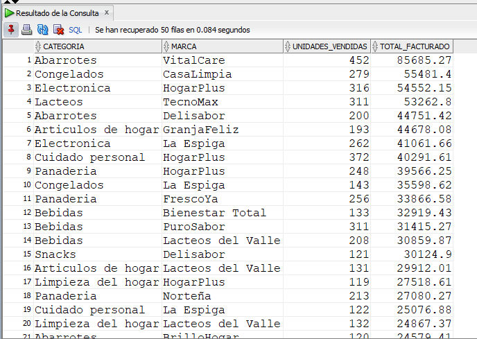

## Reporte 7: Uso de métodos de pago

**Requerimiento del Negocio**
Mostrar un listado de los métodos de pago, cantidad de pagos y monto total recibido.

**Nombre del Archivo**
`Consulta7.sql`

**Código SQL**
```sql
SELECT
    mp.nombre_metodo AS metodo_pago,                   -- Muestra el nombre comercial del método de pago utilizado.
    COUNT(DISTINCT dp.id_pago) AS cantidad_pagos,       -- Cuenta cuántas transacciones de pago únicas se registraron con este método.
    SUM(dp.monto_pagado) AS monto_total_recibido        -- Suma los montos pagados para dar el total de dinero real recibido.

FROM
    detalle_pago dp                                    -- Tabla principal que registra los abonos o pagos de las ventas.

INNER JOIN metodo_pago mp
    ON dp.metodo_pago_id_metodo = mp.id_metodo         -- Conecta cada registro de pago con su respectivo nombre de método.
INNER JOIN venta v
    ON dp.venta_numero_venta = v.numero_venta          -- Conecta el pago con la venta correspondiente.
INNER JOIN estado_venta ev
    ON v.estado_venta_id_estado = ev.id_estado         -- Conecta la venta con su estado de validez actual.

WHERE
    UPPER(ev.tipo_estado) <> 'ANULADA'                 -- Excluye del dinero recibido los pagos de facturas canceladas o anuladas.

GROUP BY
    mp.nombre_metodo                                   -- Agrupa todas las sumas y conteos por cada método de pago.

ORDER BY
    monto_total_recibido DESC;                         -- Ordena los resultados de mayor a menor según el dinero recibido.
  ```

*Evidencia visual:*

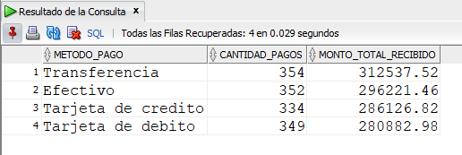

## Reporte 8: Ventas pendientes de pago

**Requerimiento del Negocio**
Mostrar un listado de las ventas con estado registrada, total de venta, total pagado —si existe— y diferencia pendiente.

**Nombre del Archivo**
`Consulta8.sql`

**Código SQL**
```sql
SELECT
    v.numero_venta AS venta,                           -- Muestra el identificador o número correlativo de la factura.
    SUM(DISTINCT dv.subtotal) AS total_venta,          -- Calcula el costo total de los productos comprados en esa venta.
    NVL(SUM(dp.monto_pagado), 0) AS total_pagado,      -- Suma el dinero abonado. Si no hay abonos, muestra 0 gracias a NVL.
    SUM(DISTINCT dv.subtotal) - NVL(SUM(dp.monto_pagado), 0) AS diferencia_pendiente -- Resta el total de la venta menos lo pagado.

FROM
    venta v                                            -- Tabla principal de registros de transacciones.

INNER JOIN estado_venta ev
    ON v.estado_venta_id_estado = ev.id_estado         -- Conecta la venta con su catálogo de estados.
INNER JOIN detalle_venta dv
    ON v.numero_venta = dv.venta_numero_venta          -- Conecta la venta con sus líneas de productos para calcular el precio total.
LEFT JOIN detalle_pago dp
    ON v.numero_venta = dp.venta_numero_venta          -- Usa LEFT JOIN para incluir ventas aunque aún no tengan ningún pago registrado.

WHERE
    UPPER(ev.tipo_estado) = 'REGISTRADA'               -- Filtra estrictamente para mostrar solo las ventas con estado 'REGISTRADA'.

GROUP BY
    v.numero_venta                                     -- Agrupa los cálculos matemáticos de manera individual por cada venta.

ORDER BY
    diferencia_pendiente DESC;                         -- Ordena la lista mostrando primero las deudas más grandes.
  ```

*Evidencia visual:*

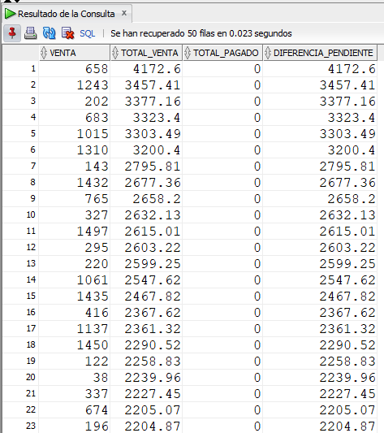